<!-- generated by build/make_effects_page.py: edit the words there, then rerun -->
# The effects

35 custom effects for the Zoom MultiStomp, plus Luca Matturro's 12 [below](#matujuice-pack). Each shows its screen on the pedal and, under it, its picture in the [MultiStomp Editor](https://themanro.github.io/ZoomMultistompZDL/tools/editor.html), which plays out what the effect does and redraws as you turn its knobs. Knob names are listed as the pedal shows them. Install them from the editor's **Effects Library**, or from [dist/](dist/) with Zoom Effect Manager.

Every effect ends with a **Mix** knob (dry/wet), except Dustbox (Power) and the live screens (they pass the sound through). Sound demos, desktop previews and build notes are in [CUSTOM_EFFECTS.md](CUSTOM_EFFECTS.md).

**Jump to:** [Delays and loopers](#delays-and-loopers) · [Reverbs](#reverbs) · [Pitch, modulation and texture](#pitch-modulation-and-texture) · [Drive and lo-fi](#drive-and-lo-fi) · [Filters, resonators and voices](#filters-resonators-and-voices) · [Live screens](#live-screens) · [Matujuice pack](#matujuice-pack)

## Delays and loopers

<table>
<tr>
<td width="300">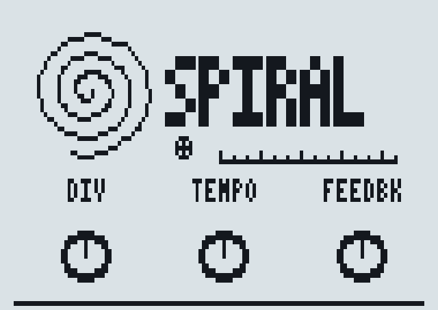 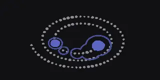</td>
<td>

### Spiral

A tempo-locked delay whose repeats climb or sink in pitch, compounding with every repeat; Glide adds a rise that starts at each note.

Div, Tempo, Feedbk, Rise, Glide, Span, Tone, Mix

</td>
</tr>
<tr>
<td width="300">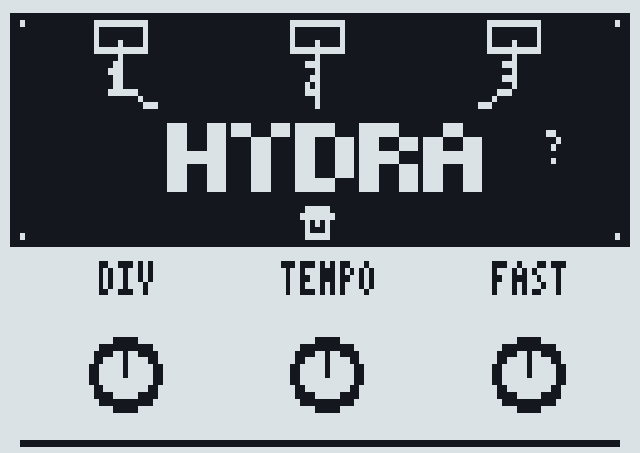 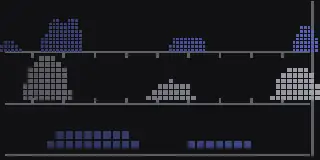</td>
<td>

### Hydra

Two extra playheads on one delay: a double-time ghost an octave up and a half-time drag an octave down, locked to tempo. Built for drums.

Div, Tempo, Fast, Slow, Tone, Mix

</td>
</tr>
<tr>
<td width="300">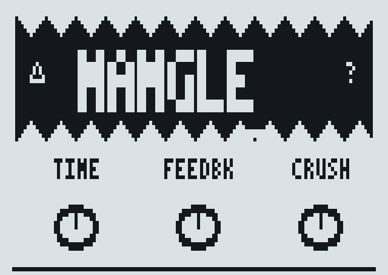 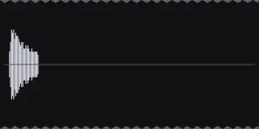</td>
<td>

### Mangle

A delay with three blendable mutations on every repeat: crush, tremolo and an octave-down shimmer. All three at 0 is a clean delay.

Time, Feedbk, Crush, Tremolo, Pitch, Mix

</td>
</tr>
<tr>
<td width="300">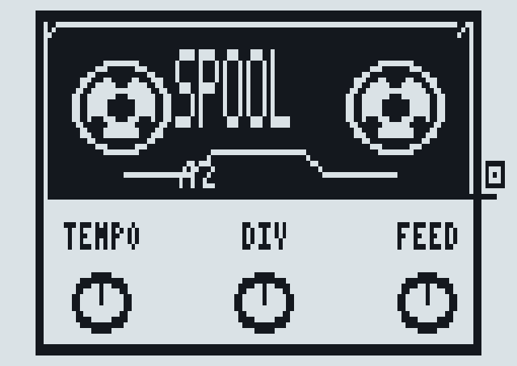 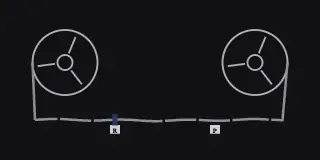</td>
<td>

### Spool

A tempo-locked tape echo with flutter, wow, head wear, drive and a spring tail. Feed self-oscillates above about 90.

Tempo, Div, Feed, Flutter, Wow, Wear, Drive, Spring, Mix

</td>
</tr>
<tr>
<td width="300">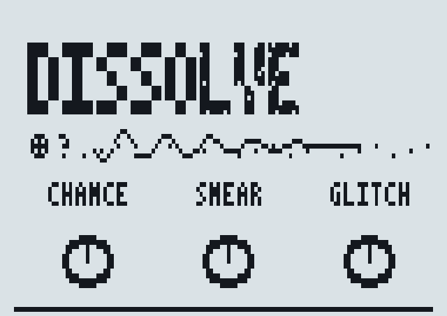 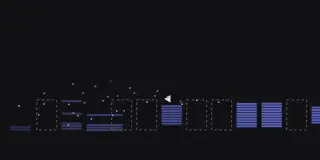</td>
<td>

### Dissolve

A glitch delay after the OBNE Parting: chunks of what you play are dropped, smeared into a wash, reversed or dropped an octave.

Chance, Smear, Glitch, Mix

</td>
</tr>
<tr>
<td width="300">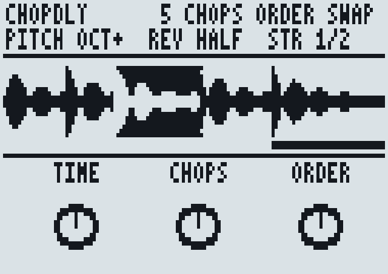 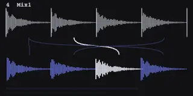</td>
<td>

### [Chopdly](src/custom/chopdly/README.md)

A delay that chops what it recorded: every repeat replays the last cycle cut into 1-16 chops (or at your notes), rearranged, reversed, pitched and stretched, and the repeats get re-chopped.

Time, Chops, Order, Pitch, Reverse, Stretch, Glide, Feedbk, Mix

</td>
</tr>
<tr>
<td width="300">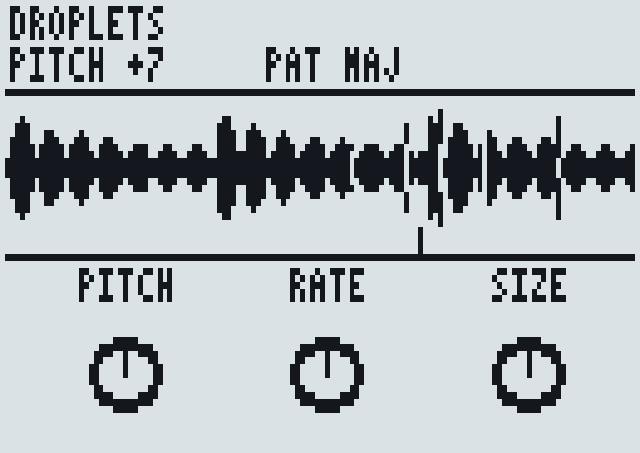 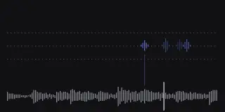</td>
<td>

### [Droplets](src/custom/droplets/README.md)

A granular delay: short grains sprayed from the last 2.5 s, with pitch steps and patterns, scan, randomness and feedback. Feedback at 100 freezes the buffer.

Pitch, Rate, Size, Contour, Scan, Pattern, Random, Feedbk, Mix

</td>
</tr>
<tr>
<td width="300">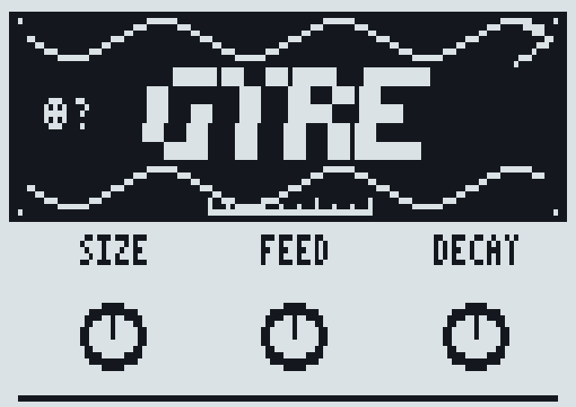 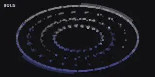</td>
<td>

### Gyre

A loop you hold that keeps spiralling: two grains half a window apart make it unity-gain, so Decay at 0 holds for ever and Rise climbs or sinks it each pass.

Size, Feed, Decay, Rise, Glide, Span, Tone, Mix

</td>
</tr>
<tr>
<td width="300">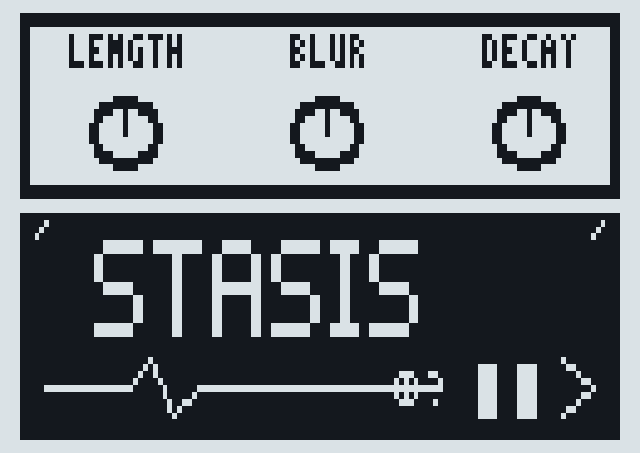 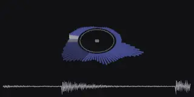</td>
<td>

### Stasis

A footswitch freeze: the note you just played is held while you play over it.

Length, Blur, Decay, Tone, Mix, Capture

</td>
</tr>
<tr>
<td width="300">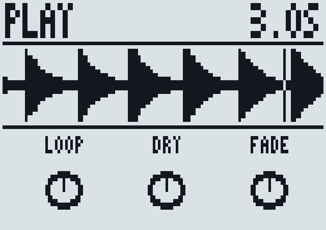 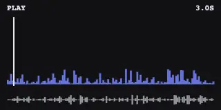</td>
<td>

### [Loop](src/custom/loop/README.md)

A looper on the footswitch: record, play, overdub, stop, clear, undo and redo, with tempo quantize and a click. About 5 s, or about 23 s in the experimental Long mode.

Loop, Dry, Fade, Undo, Long, Tempo, Beats, Click

</td>
</tr>
</table>

## Reverbs

<table>
<tr>
<td width="300">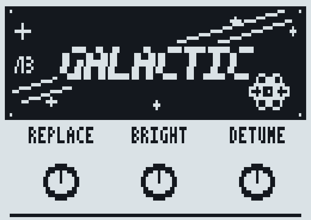 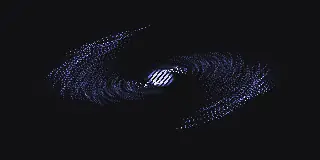</td>
<td>

### Galactic

Airwindows' lush Galactic reverb, its wet path boosted for pedal levels.

Replace, Bright, Detune, Bigness, Mix

</td>
</tr>
<tr>
<td width="300">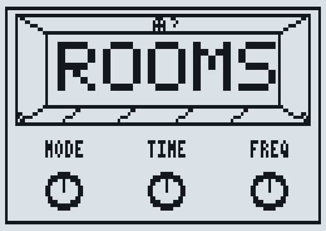 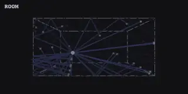</td>
<td>

### Rooms

A multi-mode reverb after the DBA Rooms: Room, Digit, Peak, Gate, Wave and Gong, with Freq and Depth reused per mode.

Mode, Time, Freq, Depth, Mix

</td>
</tr>
<tr>
<td width="300">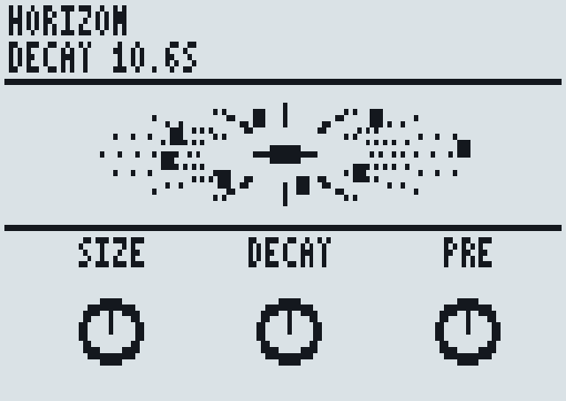 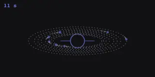</td>
<td>

### [Horizon](src/custom/horizon/README.md)

A huge, spacey reverb: eight long, slowly moving lines, from a room to a cathedral, a minute-long tail and a hold, a swell that blooms each note in.

Size, Decay, Pre, Mod, Lo, Hi, Swell, Width, Mix

</td>
</tr>
<tr>
<td width="300">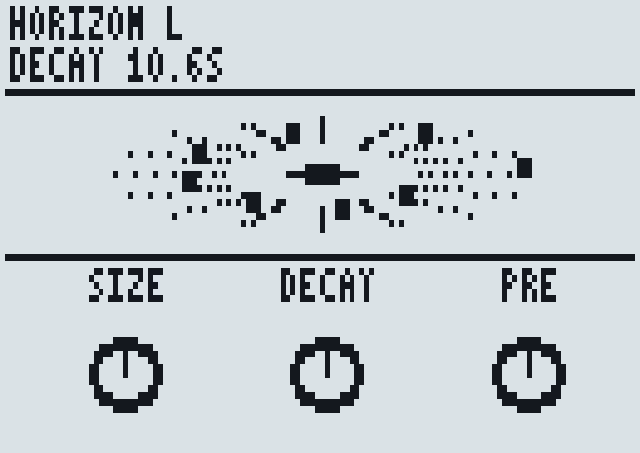 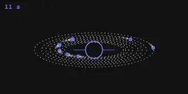</td>
<td>

### [HorizonL](src/custom/horizonl/README.md)

Horizon at half the sample rate inside: the same space for about half the DSP, for chains where Horizon crackles. Hi tops out at 10 kHz. <em>Not yet tried on the pedal.</em>

Size, Decay, Pre, Mod, Lo, Hi, Swell, Width, Mix

</td>
</tr>
</table>

## Pitch, modulation and texture

<table>
<tr>
<td width="300">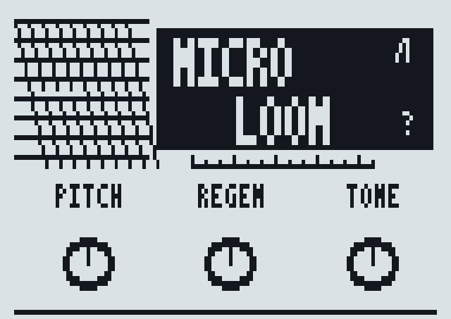 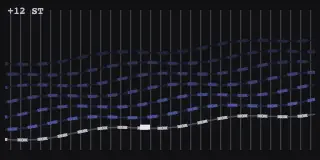</td>
<td>

### Microlm

Microloom: a granular shimmer cloud. Grains are pitched and fed back, so it builds rather than repeats.

Pitch, Regen, Tone, Mix

</td>
</tr>
<tr>
<td width="300">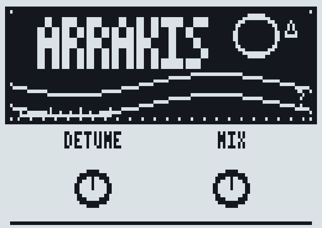 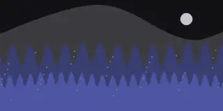</td>
<td>

### Arrakis

A Dune-style detuned sub-octave drone: two subs beating against each other.

Detune, Mix

</td>
</tr>
<tr>
<td width="300">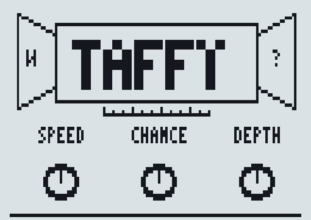 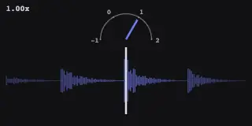</td>
<td>

### Taffy

A tape warp after the Red Panda Tensor: reverse, stop, double speed and random slips.

Speed, Chance, Depth, Glide, Mix

</td>
</tr>
<tr>
<td width="300">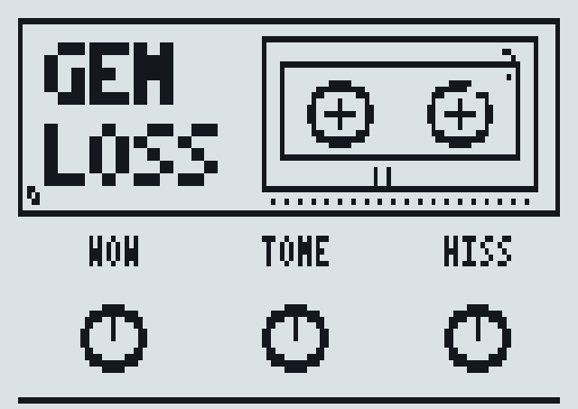 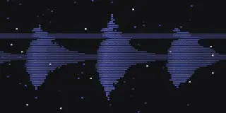</td>
<td>

### GenLoss

Tape and VHS generation loss: wow, a head-bump tone shift and hiss.

Wow, Tone, Hiss, Mix

</td>
</tr>
<tr>
<td width="300">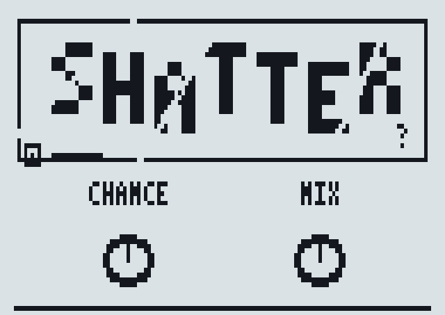 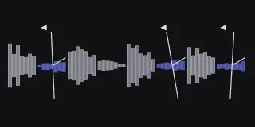</td>
<td>

### Shatter

A stutter and beat-repeat glitch for drums.

Chance, Mix

</td>
</tr>
</table>

## Drive and lo-fi

<table>
<tr>
<td width="300">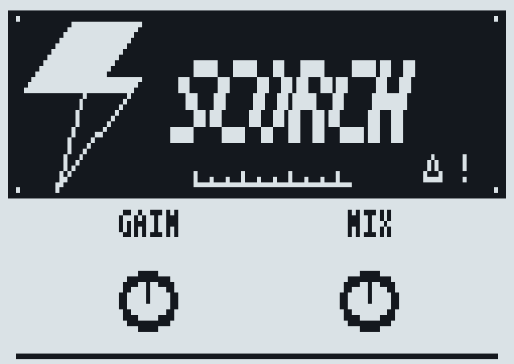 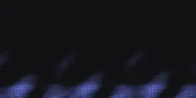</td>
<td>

### Scorch

An aggressive high-gain amp with a cab-style filter.

Gain, Mix

</td>
</tr>
<tr>
<td width="300">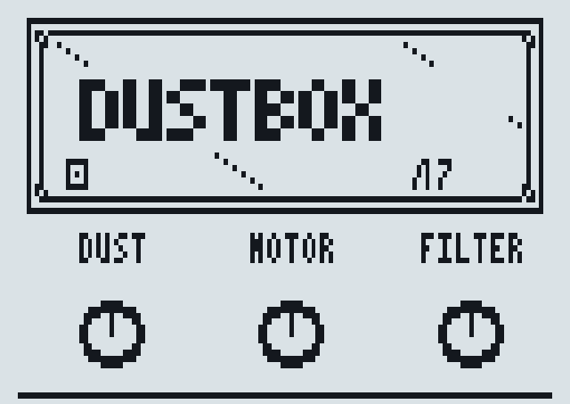 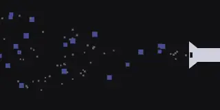</td>
<td>

### Dustbox

A Buzz Box-style fuzz with a flip-flop sub-octave. Contributed by Marcelo Fuentes (MIT).

Dust, Motor, Filter, Power

</td>
</tr>
<tr>
<td width="300">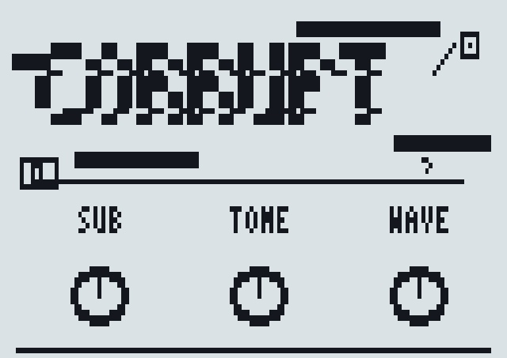 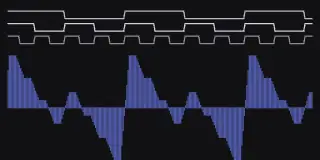</td>
<td>

### Corrupt

A Data Corrupter-style square synth: the note you play, a tracked sub and a divided harmony.

Sub, Tone, Wave, Mix

</td>
</tr>
<tr>
<td width="300">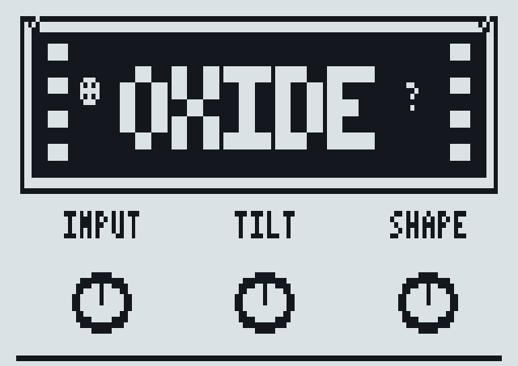 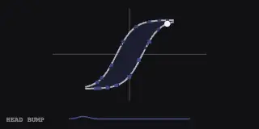</td>
<td>

### Oxide

Airwindows ToTape9: tape saturation with Dolby-style tilt, bias, flutter and head bump.

Input, Tilt, Shape, Flutter, FlutSpd, Bias, HeadBmp, Output, Mix

</td>
</tr>
<tr>
<td width="300">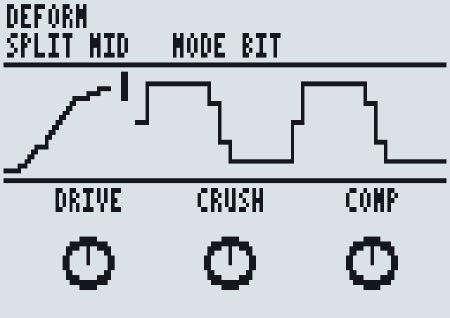 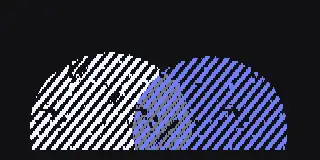</td>
<td>

### [Deform](src/custom/deform/README.md)

Drive, crush and compression in one, after the Torso S-4: two-band drive, a soft crush and a one-knob compressor, with noise that follows your playing.

Drive, Crush, Comp, Tilt, Split, Mode, Noise, Decay, Mix

</td>
</tr>
<tr>
<td width="300">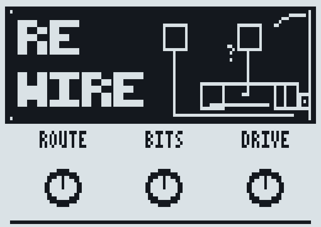 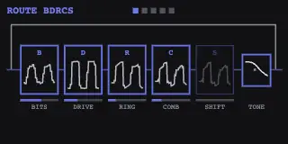</td>
<td>

### Rewire

Five lo-fi blocks (crush, drive, ring mod, comb, frequency shift) in a chain you can reorder.

Route, Bits, Drive, Ring, Comb, Shift, Tone, Mix

</td>
</tr>
<tr>
<td width="300"> </td>
<td>

### [Tonic](src/custom/tonic/README.md)

A Bitters-inspired multi-effect: drive, a phaser and one of decimate, crush, FM or ring mod, in either order. <em>Experimental: not yet tried on the pedal.</em>

Mode, Amount, Drive, Phase, Order, Mix

</td>
</tr>
</table>

## Filters, resonators and voices

<table>
<tr>
<td width="300"> </td>
<td>

### Flower

A Korg-style random sample-and-hold step filter: the "Digital Bath" sound.

Rate, Mix

</td>
</tr>
<tr>
<td width="300"> </td>
<td>

### Klang

A swept-carrier ring modulator: sirens, dive bombs and clanging metal.

Freq, Sweep, Mix

</td>
</tr>
<tr>
<td width="300"> </td>
<td>

### Howl

A Total Sonic Annihilation-style feedback loop that self-oscillates on demand.

Tune, Annihil, Mix

</td>
</tr>
<tr>
<td width="300"> </td>
<td>

### [Carillon](src/custom/carillon/README.md)

A resonant filter bank: 32 narrow filters from C2 to C8, snapped to a key and scale. A filter at low Decay, ringing bells turned up.

Cutoff, Reso, Decay, Key, Scale, Slope, Waves, Noise, Mix

</td>
</tr>
<tr>
<td width="300"> </td>
<td>

### [Chimera](src/custom/chimera/README.md)

Your guitar as the voice of a simulated throat and mouth, like a talkbox: vowels, jaw, body size, nose, and a mouth that can follow your notes or babble.

Vowel, Open, Body, Nasal, Talk, Move, Buzz, Breath, Mix

</td>
</tr>
</table>

## Live screens

<table>
<tr>
<td width="300"> </td>
<td>

### Scope

A live oscilloscope of your signal, full screen: waveform or XY. Passes the sound through.

Time, Gain, Mode

</td>
</tr>
<tr>
<td width="300"> </td>
<td>

### Spectrum

A live spectrum analyser, 40 Hz to 16 kHz, with peak hold. Passes the sound through.

Range, Fall, Tilt

</td>
</tr>
<tr>
<td width="300"> </td>
<td>

### Ring

A spinning ring that follows your signal, full screen. Passes the sound through.

Time, Size, Spin

</td>
</tr>
<tr>
<td width="300"> </td>
<td>

### Skull

A shaded 3D skull that reacts to your playing: the jaw opens, the eyes light, it jolts on attacks and explodes at the loudest. Passes the sound through.

Sense, Decay, Shake, Boom

</td>
</tr>
</table>

## Matujuice pack

Twelve effects by **Luca Matturro** ([matujuice](https://github.com/matujuice)), built on this project's toolchain and included unmodified under his MIT licence: [zoom-ms-zdl-effects-pack](https://github.com/matujuice/zoom-ms-zdl-effects-pack) v1.5, whose Tempo knobs run on stock firmware (later releases take their tempo from [MIDISTOMP](https://github.com/matujuice/zoom-ms-midistomp)). Made for synths and drum machines as much as guitar. The pedal screens are his artwork; his full guide and licence are in [dist/matujuice/](dist/matujuice/README.md). Their IDs are 480 and 485-496.

<table>
<tr>
<td width="300"> </td>
<td>

### WaveFold

A wavefolder on a Buchla 259 fold curve.

Drive, Symm, Tone, Level, Mix

</td>
</tr>
<tr>
<td width="300"> </td>
<td>

### DualShft

A tempo-synced dual pitch shifter: two voices, each with its own echo time, bent apart by one LFO.

Ptch1, Ptch2, Dly1, Dly2, Div, Depth, Shape, Tempo, Mix

</td>
</tr>
<tr>
<td width="300"> </td>
<td>

### Choral

A choir that sings the note your synth plays: sections, sizes, chords and vowels.

Choir, Size, Chord, Sing, Pace, Feel, Glide, Tempo, Mix

</td>
</tr>
<tr>
<td width="300"> </td>
<td>

### EuGate

A Euclidean rhythm gate.

Notes, Steps, Shift, Swing, Reset, Gap, Soft, Tempo, Mix

</td>
</tr>
<tr>
<td width="300"> </td>
<td>

### DubSiren

A dub siren with its own tape echo, played from the footswitch.

Trig, Mode, Pitch, Rate, Depth, Vol, Time, Tempo, Fdbk

</td>
</tr>
<tr>
<td width="300"> </td>
<td>

### SGNL

S.GN_L, a broken digital line: lost packets, dropouts and codec damage.

Loss, Size, Codec, Fill, Burst, Jump, Line, Edge, Mix

</td>
</tr>
<tr>
<td width="300"> </td>
<td>

### Scrub

Scrub through the last seconds and freeze where you stop.

Pos, Grain, Rec, Glide, Dir, Spray, Mix, Tempo

</td>
</tr>
<tr>
<td width="300"> </td>
<td>

### GridDly

One tempo-synced delay with six engines.

Type, Time, Fdbk, Tone, Char, Duck, Mix, Tempo, Tail

</td>
</tr>
<tr>
<td width="300"> </td>
<td>

### SyncEQ

An EQ that passes the bar sync on to the effects after it.

LoCut, Low, Mid, MidF, High, HiCut, Drive, Tempo, Level

</td>
</tr>
<tr>
<td width="300"> </td>
<td>

### Breather

A tempo-synced pump with a reverb.

Targt, Shape, Depth, Div, Shift, Curve, Verb, Tempo, Size

</td>
</tr>
<tr>
<td width="300"> </td>
<td>

### DirtBox

A distortion box for acid lines: seven classic pedal models, EQ and a noise reducer.

Model, Drive, Tone, Low, Mid, High, ZNR, Level, Mix

</td>
</tr>
<tr>
<td width="300"> </td>
<td>

### Sweep

A phaser, flanger and filter in one, on a tempo-locked LFO.

Type, Rate, Depth, Cntr, Reso, Shape, Tone, Tempo, Mix

</td>
</tr>
</table>
