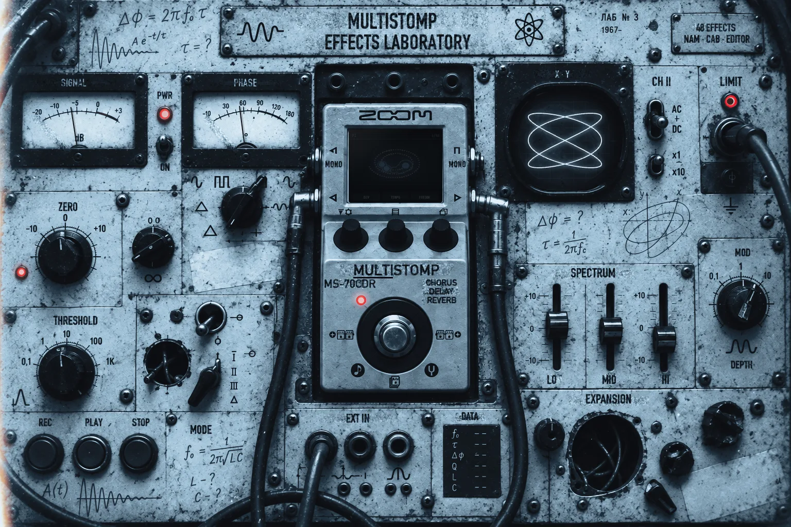
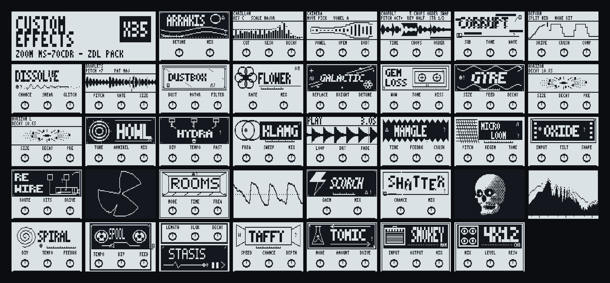
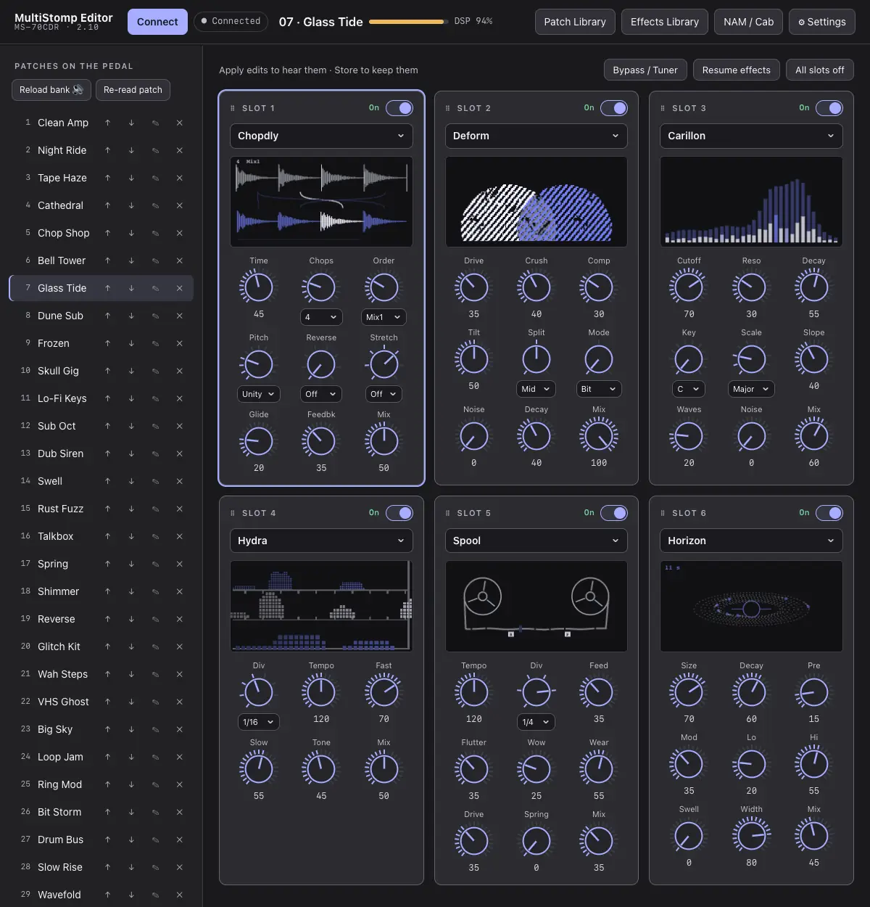
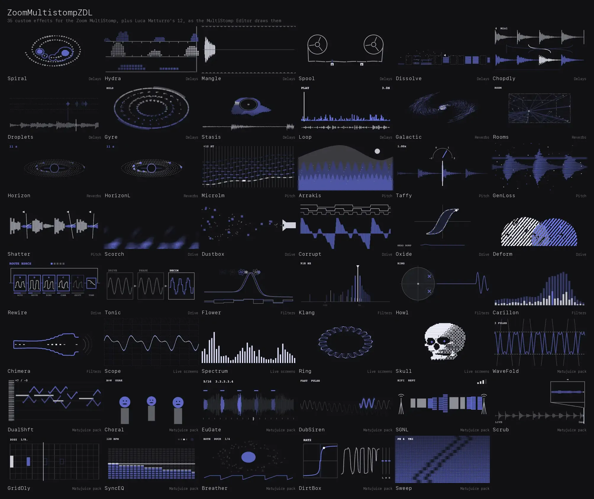
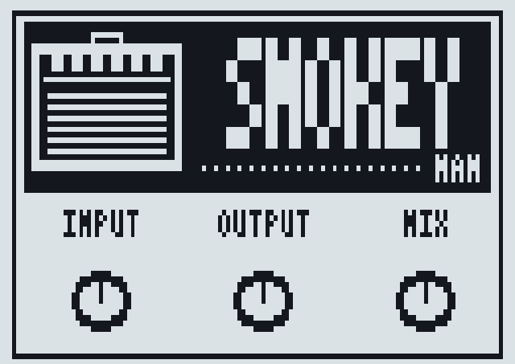
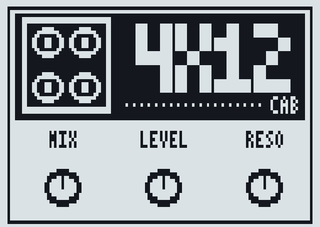

# New effects, NAM A2 & Cab loader, editor for Zoom Multistomp pedals

<p align="center"></p>

**35 custom effects for the Zoom MultiStomp pedals, and the MultiStomp Editor:
a free browser app that installs them over USB and edits your patches.** No
custom firmware, no Zoom SDK, nothing to compile. Everything here was built by
reverse-engineering Zoom's effect format.

This was a good amount of work and tokens, please consider to [Sponsor this project](https://github.com/sponsors/themanro) or [Buy me a coffee](https://buymeacoffee.com/sz0kfixkct)

<p align="center"></p>

**[▶ Open the MultiStomp Editor](https://themanro.github.io/ZoomMultistompZDL/tools/editor.html)** ·
**[See every effect](EFFECTS.md)** ·
**[Video walkthrough](https://youtu.be/gNDif0cOdFk)** (an earlier version) ·
in [The Verge](https://www.theverge.com/gadgets/1013493/vibe-coding-ai-music-gear-hacking-custom-firmware)

## Get started

1. Plug the pedal in over USB and open the
   **[MultiStomp Editor](https://themanro.github.io/ZoomMultistompZDL/tools/editor.html)**
   in **Opera or Edge** (Safari and Firefox have no Web MIDI; Chrome 152 has a
   Web MIDI bug that stops the pedal's replies). Close Zoom Effect Manager
   first: it holds the MIDI port.
2. Click **Connect**.
3. **Effects Library → Back up all files**, then install the effects you want
   and power-cycle the pedal.
4. Pick them in a patch's slots and turn the knobs.

Tested on the **MS-70CDR, firmware 2.10**; see [Compatibility](#compatibility)
for the other pedals. Back up your patches too (**Settings → Advanced → Pedal bank
backup**): an experimental effect can freeze the pedal until it is
power-cycled, and [here is what to do](#if-the-pedal-freezes) if one won't boot.

## The MultiStomp Editor

<p align="center"></p>

One page in your browser, nothing installed and nothing sent anywhere. Your
patch library lives in your own browser.

* **Patches:** the pedal's 50 patches on the left. Load, rename, reorder,
  erase, back up and restore the whole bank; keep your own library in the
  browser.
* **Six slots:** every effect's knobs, named steps where a knob has them, and
  a moving picture of what the effect does that follows its knobs. Drag slots
  to reorder them. Slots 1–3 follow your knob moves live; slots 4–6 can't be
  edited live on this pedal, so the editor applies them for you
  ([why](docs/MIDI-PARAM-EDIT.md)).
* **DSP meter:** adds up the chain the way the pedal does, and turns amber,
  then red before the pedal would refuse it with `DSP full`.
* **Effects Library** (MS-70CDR): installs, updates and removes this
  project's effects over USB, with every write read back; backs up and
  restores all the pedal's files, which also undoes Zoom's firmware updater
  resetting the effect list. Zoom's own effects are listed apart, and can be
  removed to make room ([how it works](docs/EFFECT-INSTALL-PROTOCOL.md)).
* **NAM / Cab:** turns an amp capture or a cab IR into an effect and installs
  it ([below](#nam-captures-and-cabinets)).
* **Settings:** a MIDI controller for the knobs, the bank backup, diagnostics,
  and the classic editor, the same features in the original design.

The [Cover Editor](https://themanro.github.io/ZoomMultistompZDL/tools/cover_editor.html)
draws the 128×64 picture an effect shows on the pedal.

## The effects

**[EFFECTS.md](EFFECTS.md)** has every effect with its screen on the pedal, its
moving picture from the editor, what it does and its knobs. In short:

| | |
|---|---|
| **Delays and loopers** | Spiral, Hydra, Mangle, Spool, Dissolve, Chopdly, Droplets, Gyre, Stasis, Loop |
| **Reverbs** | Galactic, Rooms, Horizon, HorizonL, Cloud |
| **Pitch, modulation and texture** | Microloom, Arrakis, Taffy, GenLoss, Shatter |
| **Drive and lo-fi** | Scorch, Dustbox, Corrupt, Oxide, Deform, Rewire, Tonic |
| **Filters, resonators and voices** | Flower, Klang, Howl, Carillon, Chimera |
| **Live screens** | Scope, Spectrum, Ring, Skull: they draw your signal on the pedal's screen |

<p align="center"><a href="EFFECTS.md"></a></p>

All of them sit in the pedal's **Delay** category and end with a **Mix**
knob (Dustbox ends with Power; the live screens pass the sound through). The
live screens and the animated effect screens need firmware 2.10 on the
MS-70CDR; elsewhere they still work as audio effects. The live screens also
animate on the G1on family (G1on and G1Xon 1.21, B1on and B1Xon 1.30), thanks
to Barsik-Barbosik ([#12](https://github.com/themanro/ZoomMultistompZDL/issues/12),
tested on a B1Xon). The pedal can't hold or run all of them at
once: install the ones you'll use, and run the heavy ones (Microloom,
Galactic, Spool, Horizon) one per patch.

Also included: **Luca Matturro's Matujuice pack**, twelve more effects made
for synths and drum machines on this toolchain (MIT). They're
[on the effects page](EFFECTS.md#matujuice-pack).

## NAM captures and cabinets

**Beta: testers wanted.** Your own amp captures
([NAM](https://www.neuralampmodeler.com/)) and cabinet IRs as effects on the
pedal. In the editor's **NAM / Cab** panel, pick a capture from
[TONE3000](https://www.tone3000.com/) or a file, give it a name and an icon,
and install it. It's converted in your browser; nothing is uploaded.

<table>
<tr>
<td align="center"><br>A capture, <code>smokey</code></td>
<td align="center"><br>A cab, <code>4x12</code></td>
</tr>
</table>

* **A2 Lite captures only**, the small standard NAM architecture; larger
  models don't fit this DSP. Captures trained at 44.1 kHz (the pedal's rate)
  sound closest to the amp.
* **Knobs.** NAM: Input, Output, Mix, Bass, Mid, Treb, Gate. A split version
  puts the amp on one output and your dry guitar on the other. CabIR: Mix,
  Level, Reso, Pres.
* **DSP.** A full-rate capture takes most of the pedal (194 of about 225),
  leaving room for a drive or a cab; **Eco** (181) and **Eco+** (152) trade a
  little treble for room. A cab costs 10: a short filter plus a few EQ bands,
  after the [Hybrid IR](https://github.com/Leemuzhko/HYBRID-IR) idea.
* **Hundreds of slots**, each with its own effect ID, so captures and cabs sit
  side by side. Replacing a capture keeps its slot, so patches that used it
  play the new one.

Only tested on one MS-70CDR so far. Read
[If the pedal freezes](docs/NAM-LOADER.md#if-the-pedal-freezes) before you
install, and please report what you find with the
[NAM / Cab report form](https://github.com/themanro/ZoomMultistompZDL/issues/new?template=nam-cab-report.yml).
Details: [the NAM guide](docs/NAM-LOADER.md). Your captures stay yours: the
built files are gitignored and the templates hold no capture data.

## Installing with Zoom Effect Manager

The editor's Effects Library is the easiest way. Zoom Effect Manager (2.3.3
or newer) still works, and is the only way on pedals the library doesn't
support yet:

1. In Effect Manager's **Settings**, choose **Read Effects from folder** and
   pick this repo's [dist/](dist/) folder.
2. In the effect browser, tick both **Effects from devices** and **From
   Folder** (without the second it shows "No data to display").
3. Add the effects you want and write them to the pedal.

Before writing effects from several projects, run your folder through the
editor's **Effects → Check effect files before installing**: it lists the
files that share an effect ID, which can freeze the pedal at boot. No pedal
needed.

Keep each `.png` beside its `.ZDL`: it's the thumbnail Effect Manager shows.
Effect Manager won't replace an installed effect with the same ID: remove it
first, then add the new one. `FS.bin size mismatch` means the pedal is full.
More in [the install guide](docs/INSTALLING-ZDLS.md).

## If the pedal freezes

If a patch with a bad effect freezes the pedal at the boot screen: power off,
hold the **leftmost knob pressed in**, power on, choose `All INITIALIZE` and
press the footswitch. That resets the patches to factory (restore them from
your backup) but keeps the installed effects; then remove the bad one.

## Compatibility

| Pedal | Status |
|---|---|
| **MS-70CDR**, firmware 2.10 | The pedal everything here is built and tested on. |
| **MS-50G**, firmware 3.10 | NAM (full rate and Eco) and CabIR confirmed by a user ([#5](https://github.com/themanro/ZoomMultistompZDL/issues/5)); editor writes passed the opt-in write test, which also unlocks installing effects from the editor (not yet tried on an MS-50G). Still experimental. |
| **MS-60B, G1on, G1Xon, B1on, B1Xon** | Same effect format. The live screens (Skull, Ring, Scope, Spectrum, Loop) load and animate on a B1Xon, on its own firmware 1.30 and on G1Xon 1.21 ([#12](https://github.com/themanro/ZoomMultistompZDL/issues/12)); no editor support yet ([#13](https://github.com/themanro/ZoomMultistompZDL/issues/13)). MS-60B: awaiting reports. |
| **MS-100BT** | Effects confirmed by a user, installed over Bluetooth with [lopezchau's tools](https://github.com/lopezchau/zoom-ms100bt-bluetooth) or [MS StompCtrl](https://github.com/1njected/ms-stompctrl) ([#4](https://github.com/themanro/ZoomMultistompZDL/issues/4)). No USB MIDI, so no editor. |
| **Plus models** (MS-50G+, MS-60B+, MS-70CDR+) and the **Four series** | Not supported: they use Zoom's newer ZD2 format. For NAM on a Plus pedal, use [nam2zoom](https://github.com/freelender/nam-to-zoom) by Aleksandar Vukasinovic. |
| Original G3/G3X, G5, B3, A3 | Same DSP family, not supported or tested. |

On any pedal but the MS-70CDR the editor connects read-only until you opt in
to its write test. More: [pedal research notes](docs/pedal-research/README.md),
[ZD2 notes](docs/ZD2-PORT-NOTES.md), and
[probing a new pedal](docs/PROBING-A-NEW-PEDAL.md) if you have one we haven't
seen.

## What We Learned (field notes)

Hard-won findings from getting these effects stable on real hardware. The
deep versions live in [docs/](docs/) and [build/ABI.md](build/ABI.md).

### The two confirmed freeze classes

1. **Code→data relocations.** Any `static` array referenced from the audio
   function (even `static const float[]`) forces a relocation and freezes the
   pedal at load. Bake tables as `#define` scalar literals or unrolled
   macro sums instead — they compile to immediates. A clean build prints
   `.fardata: 0 bytes` and `Applied 0 .obj relocations`; anything else is a
   red flag. (This froze Spool until its 64-tap FIR was unrolled.)
2. **Unresolved runtime helpers.** Any float division, integer `/` or `%`,
   or math-lib call (`sinf`, `powf`, …) emits a `__c6xabi_*` helper the
   loader can't resolve — the branch goes to address 0. Use polynomial
   sin/cos, Newton-iteration reciprocals, and bit-mask tricks instead of
   modulo. See [docs/SAFE-DSP-RULES.md](docs/SAFE-DSP-RULES.md).

### Memory and CPU budgets

- The host gives each effect instance a large state arena via `ctx[3]`,
  hardware-probed to **≥705,536 bytes** — Lush-class (512 KB) and Spool-class
  (545 KB) states load fine. Always bounds-check the descriptor and clear big
  buffers lazily in chunks.
- **DSP cost** is a float the effect declares in its descriptor (stock
  effects declare 11.6–128). The pedal sums it across the patch and refuses
  the patch with `DSP full` above a limit measured at 224.4–228.4. The linker
  defaults to 20.0; heavy effects set an honest value (`LinkerConfig.dsp_cost`)
  — NAM declares 194/177, CabIR 10. Declaring too little lets the firmware
  green-light a chain the DSP can't run: crackles, or a hang at patch load.
- **File size cap:** a ZDL over ~32 KB freezes the pedal at boot (largest
  proven: 32,126 bytes file, 29,576 bytes code+data; 30,336 froze).
  [build/zdl_size_guard.py](build/zdl_size_guard.py) enforces it.

### Parameters are hostile

- The proven knob path delivers **normalized 0..1 floats** (an earlier ×7.14
  scaling assumption made every knob saturate at ~14% travel).
- **Saved parameters now initialize at patch load.** The former freeze came
  from absolute handler call targets that lacked relocation records; the linker
  now emits PC-relative calls. All 22 release effects enable the corrected init.
  MatProb and Rooms are hardware-confirmed in all six slots, across patch changes
  and power cycles with the editor disconnected. The remaining effects are built
  and statically checked, with hardware listening still pending. See
  [docs/PARAM-INIT-INVESTIGATION.md](docs/PARAM-INIT-INVESTIGATION.md).
- The editor retains live-parameter replay for slots 1–3 for compatibility with
  older installed binaries. It cannot identify the installed build from its
  effect ID alone. Slots 4–6 still lack live `0x31` edits; initialization and
  editor-side update behavior are separate concerns.
- **Refocusing an effect in the chain UI clobbers its param block with
  garbage** until wiggled. The fix (piloted in Howl v3) is an edit-driven
  knob latch: a real knob turn changes one slot at a time, so bulk rewrites
  are detected and ignored, and the effect keeps sounding as dialed.
- Up to 9 params work (3 pages × 3), image shows the first three knobs;
  the multi-knob synthesized-handler path is hardware-proven.

### Feedback DSP on this box

- Never feed a resonant filter back into itself — loop gain crosses unity
  almost everywhere. Use a pole-radius-controlled resonator (radius < 1 is
  unconditionally stable); that's how Howl works.
- A cubic soft-clip has **1.5× gain at small signal** — inside a feedback
  loop that multiplies loop gain and self-oscillates. Use a unity-slope
  clipper (`x − x³/6.75`) in loops. (Caught twice: Scorch's output, then
  Dissolve's smear loop.)

### Covers, screens, thumbnails

- The on-device cover is the **full 128×64**, 1-bpp, column-major in eight
  8-row blocks, run-length encoded. The firmware paints live 20×15 knob-value
  boxes on top at coordinates the ZDL declares — so draw labeled dials under
  them, stock-style ([build/decode_picture.py](build/decode_picture.py)
  decodes any ZDL's cover; ~130 stock covers were decoded to learn this).
- The LCD pixels are ~1.3× taller than wide: pre-compress artwork vertically
  or circles render as tall ellipses.
- Hand-drawn covers: [tools/cover_editor.html](tools/cover_editor.html) is a
  self-contained pixel editor with a device-aspect preview; exported JSON in
  `src/airwindows/common/covers/` overrides the generated cover at build time.

### Identity and packaging

- ZDL basenames must be **≤ 8 characters** and unique after truncation, or
  effect identities collide and the pedal freezes at boot. The effect DB build
  refuses a `dist/` that breaks this.
- There is **no sort field** in the header — on-device browse order tracks
  fxid. This pack uses 450+ to avoid stock collisions.
- gid ↔ category must match the exported symbol prefix
  (1=DYN, 2=FLT, 3=DRV, 6=CHO/MOD, 8=DLY, 9=REV); everything here is gid 8
  (`Fx_DLY_*`) so the pack lives together in the least crowded menu.
- **Reserved effect IDs** (Delay group; FXIDs go up to 1023): this pack
  403–499 (Deform: 417, Chimera: 418, Horizon: 419, HorizonL: 420, Carillon: 421, Droplets: 422, Cloud: 423), 914 (Spool) and 947 (Chopdly), NAM captures 900–907, 950–957 and 500–699, CabIR
  cabs 930–945 and 700–899. Other projects building effects for these pedals:
  please avoid them. 409 is retired: Spool and TEcho4 (another collection)
  both used it, and swapping them froze a pedal at boot. 492 and 497 are
  retired too: Droplets and Carillon first shipped there, but Matujuice's
  Washout and Looper use them. An effect is
  identified by its group and ID together: Zoom's own effects reuse IDs across
  groups (DELAY, COMP, LINESEL, TREMOLO and HDHALL are all ID 8), and Skull
  (Delay 416) runs beside SpaceHole (Reverb 416). So a new Delay effect needs
  an ID no other collection uses in the Delay group
  ([repeat98's registry](https://github.com/repeat98/ZoomMultistompZDL/blob/main/docs/FXID-REGISTRY.md)
  lists them). **Delay 958–1023 are local IDs: don't ship an effect there.**
  When an effect's ID is already taken on a pedal, Modwerk's pedal page moves
  it to a free local ID as it installs it: the ID is only in the file header,
  and an MS-70CDR ran, saved and recalled Scorch moved to 917, 1000 and 1023
  ([re-ID probe](src/hardware_probes/reid/README.md)). The MultiStomp Editor
  never gives a new NAM capture or cab a slot whose ID another effect on the
  pedal already has: it takes the next free slot instead.

## Build Your Own Effects

Start from a small effect in [src/custom/](src/custom/) (e.g. `reel` or
`klang`). Copy the directory, give the effect a new name and an unused `fxid`
in `manifest_pedal.json`, update the C audio function and `build.py`, then add
it to [build_all.py](build_all.py).

Keep the first hardware test boring: `audio_nop: true` or tiny pass-through
DSP, no static arrays, no divides, magic shuttle preserved. The safe path is
[docs/SAFE-DSP-RULES.md](docs/SAFE-DSP-RULES.md); effect directory conventions
are in [src/airwindows/README.md](src/airwindows/README.md).

## Build From Source

Zoom's and TI's files (stock effects, firmware, the stock handler blobs the
linker uses, TI's manuals) are not in this repository; see
[STOCK-FILES.md](docs/STOCK-FILES.md) for what a build needs locally.

Building requires Python 3.10+ and the TI C6000 Code Generation Tools
(v8.5.0). Installing prebuilt effects from [dist/](dist/) does not.

The build scripts expect the TI compiler here (edit `TI_ROOT` in the
per-effect `build.py` if yours differs):

```text
/Applications/ti/ti-cgt-c6000_8.5.0.LTS
```

```bash
python3 -B build_all.py            # every release effect, with load initialization -> dist/
python3 -B build_all.py taffy      # one effect
python3 -B build_all.py --all      # + diagnostic/probe builds (-> build/probes/)
```

`build_all.py` also re-extracts the editor's inline effect database at the
end, so the editor cannot go stale against `dist/`. It silently did, twice.
The README and effects-page pictures are rebuilt with
`build/make_thumb_png.py`, `build/make_gallery_png.py`,
`build/make_fx_previews.py` and `build/make_effects_page.py`.

Desktop listening previews for the originals (no compiler, no pedal) are in
[tools/audio_preview/README.md](tools/audio_preview/README.md).

### Testing without a pedal

There is a headless C674x emulator (Ziddle) that runs these ZDLs, plus a test rig
in [tools/emulator/](tools/emulator/) that reports whether `_init` completes and
whether params materialized. It is authoritative about instruction semantics and
**cannot see firmware readiness** — it passed four `_init` builds that froze the
pedal. Setup and limits: [docs/EMULATOR-TESTING.md](docs/EMULATOR-TESTING.md).

`build/disassemble_zdl.py` disassembles any ZDL, ours or one of Zoom's ~830 stock
effects in `stock_zdls/` (kept locally: [STOCK-FILES.md](docs/STOCK-FILES.md)). Diffing a generated handler against the stock
equivalent has been the most productive debugging tool in the project.

## Technical Notes

This repo builds loadable Zoom `.ZDL` effects without Zoom's unreleased SDK:

| Path | Purpose |
|---|---|
| [build/linker.py](build/linker.py) | Static linker: TI C6000 `.obj` → complete Zoom `.ZDL` (header, descriptor table, image info, edit handlers). |
| [build/decode_picture.py](build/decode_picture.py) | Decode any ZDL's on-device cover + knob-box layout back to pixels/PNG. |
| [tools/cover_editor.html](tools/cover_editor.html) | Browser pixel editor for covers, with device-aspect preview. |
| [tools/editor.html](tools/editor.html) | The MultiStomp Editor ([open](https://themanro.github.io/ZoomMultistompZDL/tools/editor.html)): it loads `patch_editor.html` and runs it under its own layout and styles, so features and fixes land in both. |
| [tools/patch_editor.html](tools/patch_editor.html) | The editor itself, in its original design (Settings → Editor switches between the two). Web MIDI; knows **custom effects** (names and knobs extracted from the ZDLs; other editors only know Zoom's). |
| [tools/fx_visuals.js](tools/fx_visuals.js) | The editor's moving picture of each effect. [tools/fx_gallery.html](tools/fx_gallery.html) shows any effect's at three knob settings. |
| [build/extract_effect_db.py](build/extract_effect_db.py) | Regenerate the editor's effect database from dist/ + stock ZDLs. |
| [src/custom/](src/custom/) | Original effects. |
| [src/airwindows/](src/airwindows/) | Airwindows-derived ports. |
| [src/hardware_probes/](src/hardware_probes/) | Diagnostic ZDLs used to map the pedal runtime ABI. |
| [dist/](dist/) | Release `.ZDL` files; never probes. |
| `stock_zdls/` | Zoom's stock effects, used for comparison and layout ground truth. Kept locally, not in the repository ([STOCK-FILES.md](docs/STOCK-FILES.md)). |

Known runtime map for custom ZDLs:

| Field | Meaning |
|---:|---|
| `ctx[1]` | parameter float table |
| `ctx[4]` | dry/guitar input buffer |
| `ctx[5]` | current effect buffer, 8 left samples then 8 right samples |
| `ctx[6]` | output accumulator for effects that add instead of processing in place |
| `ctx[11]` / `ctx[12]` | magic shuttle; preserve every audio call |
| `ctx[2] + 0x10` / `ctx[2] + 0x18` | small persistent per-instance state blocks |
| `ctx[3][0..2]` | large per-instance descriptor: base, end, byte span (≥705,536 B) |

## Repository Layout

```text
ZoomMultistompZDL/
├── README.md
├── build/                 linker, ELF/ZDL helpers, cover decoder, handler blobs
├── docs/                  install notes, ABI status, and porting guidance
├── dist/                  release ZDLs and their Effect Manager thumbnails
├── graphics/              pedal screens, editor pictures (fx/), README art
├── tools/                 MultiStomp Editor, Cover Editor, NAM loader, audio preview
├── src/custom/            original effects
├── src/airwindows/        Airwindows-derived ports + shared helpers
├── src/hardware_probes/   diagnostic ZDLs for runtime ABI experiments
├── stock_zdls/            Zoom's stock effects, kept locally (not in the repo)
└── build_all.py           release/probe build entrypoint
```

Several research references are useful locally but intentionally git-ignored:
`airwindows-ref/`, `zoom-fx-modding-ref/`, `ZoomPedalFun-main/`. If you clone
them beside the repo, treat them as read-only references.

## Documentation

| Doc | What it covers |
|---|---|
| [EFFECTS.md](EFFECTS.md) | Every effect: pedal screen, editor picture, what it does, knobs. |
| [CHANGELOG.md](CHANGELOG.md) | What changed, newest first. |
| [HANDOFF.md](HANDOFF.md) | **Start here** if you are picking this project up: current state, how to test, and what has already been ruled out. |
| [docs/PARAM-INIT-INVESTIGATION.md](docs/PARAM-INIT-INVESTIGATION.md) | How the param-materialization bug was actually diagnosed — unrelocated absolute call targets — and the firmware tracing behind it. |
| [docs/RELEASE-INIT-AUDIT.md](docs/RELEASE-INIT-AUDIT.md) | Rolling the fix out across all 22 effects, plus four follow-up defects found in the audit. |
| [docs/INIT-MATERIALIZATION.md](docs/INIT-MATERIALIZATION.md) | Investigation record for the same bug, including four `_init` attempts that froze the pedal and the reasoning that went wrong. |
| [docs/EMULATOR-TESTING.md](docs/EMULATOR-TESTING.md) | Running ZDLs headlessly against an emulated C674x, and the firmware behaviour it cannot see. |
| [docs/EDIT-HANDLER-ABI.md](docs/EDIT-HANDLER-ABI.md) | How generated edit handlers work, and why they delegate to `ctx[7]`. |
| [docs/MIDI-PARAM-EDIT.md](docs/MIDI-PARAM-EDIT.md) | SysEx protocol for live param edits; the slots 1–3 rule. |
| [docs/LOADER-SAFETY.md](docs/LOADER-SAFETY.md) | Catalogued freeze causes mapped to their triggers. |
| [docs/INSTALLING-ZDLS.md](docs/INSTALLING-ZDLS.md) | Installing effects: the editor's Effects Library, or Zoom Effect Manager. |
| [docs/SAFE-DSP-RULES.md](docs/SAFE-DSP-RULES.md) | Pedal-safe DSP/linking constraints learned from hardware failures. |
| [docs/ZDL-REVERSE-ENGINEERING-STATUS.md](docs/ZDL-REVERSE-ENGINEERING-STATUS.md) | Current map of the ZDL wrapper, runtime ABI, and known state fields. |
| [docs/STATE-ABI-PROGRESS.md](docs/STATE-ABI-PROGRESS.md) | Hardware-proven state/edit-handler findings. |
| [docs/AIRWINDOWS-EXACT-PORTS.md](docs/AIRWINDOWS-EXACT-PORTS.md) | Rules for what can and cannot be called a 1:1 Airwindows port. |
| [docs/CONTRIBUTING.md](docs/CONTRIBUTING.md) | Hardware-test asks and contribution notes. |
| [build/ABI.md](build/ABI.md) | Low-level linker/runtime ABI reference for developers. |
| [docs/TI-PDF-NOTES.md](docs/TI-PDF-NOTES.md) + TI PDFs | TI C6000 toolchain references. |
| [docs/pedal-research/](docs/pedal-research/README.md) | What's known about every other Zoom pedal people ask about: effect format, install path, IDs, risks and the next safe experiment. |
| [docs/PROBING-A-NEW-PEDAL.md](docs/PROBING-A-NEW-PEDAL.md) | How to find out whether a pedal this project has never seen — the `+` models especially — is analysable, talks MIDI, and hands over patches. |

## Related projects

| Project | What it is |
|---|---|
| [MS StompCtrl](https://github.com/1njected/ms-stompctrl) | Browser-only patch editor and backup tool for the **MS-100BT**, over Bluetooth in Chrome ([open it](https://1njected.github.io/ms-stompctrl/)). Reads, edits and writes patches, backs up the bank, and installs `.ZDL` files. A user has run four of this repo's effects on the MS-100BT ([#4](https://github.com/themanro/ZoomMultistompZDL/issues/4)); back up first and report what you find. MIT. |
| [MIDISTOMP](https://github.com/matujuice/zoom-ms-midistomp) | Custom firmware for the original MultiStomps (MS-50G, MS-60B, MS-70CDR on 2.10): MIDI Program Change, CC control of every knob, MIDI clock with Start/Stop, effect chain routing, a tempo-synced looper (GRDLOOP), Perform mode, meters, DSP limit 300. Installed by flashing a modified Zoom updater (riskier than an Effect Manager install). Our effects, their live screens and the MultiStomp Editor are expected to work on it ([MIDISTOMP-COMPAT](docs/MIDISTOMP-COMPAT.md), not yet tried on a pedal); Loop's Long mode is off there. MIT. |
| [Matujuice ZDL effects pack](https://github.com/matujuice/zoom-ms-zdl-effects-pack) | Luca Matturro's custom effects, built on this toolchain, made for synths and drum machines. v1.5 is [included here](EFFECTS.md#matujuice-pack); v1.6 and later follow MIDISTOMP's tempo (120 BPM on stock firmware). MIT. |
| [repeat98/ZoomMultistompZDL](https://github.com/repeat98/ZoomMultistompZDL) | The upstream ZDL toolchain this fork started from. |
| [Gungun-blip/ZoomMultistomp45Newzdl](https://github.com/Gungun-blip/ZoomMultistomp45Newzdl) | 45 effects (reverbs, delays, loopers, modulation, fuzz, lo-fi) as ready-made `.ZDL` files, each listed in [effects.csv](https://github.com/Gungun-blip/ZoomMultistomp45Newzdl/blob/main/45BetaZDL/effects.csv) with its inspiration, knobs, IDs and checksum. Posted 2026-11-16 as a draft: its own RIGHTS.md says the binaries are not yet cleared for distribution, and its README targets the MS-70CDR while the repo says only tested on the MS-50G. No source. Before installing any of them next to this pack: its **Spool.ZDL** is a different effect with the same file name as ours (install only one); most of its IDs are above 1023, and a patch keeps only 10 bits of an ID, so Oil Can Delay (Delay 1474) saves as Delay 450 = our Microloom, Patchwork (Delay 1508) as 484 = our Gyre, and Harmonic Tremolo (Mod 1160) as 136 = Zoom's Ba Detune. Its Manipulation Looper credits our Loop. |
| [nam2zoom](https://github.com/freelender/nam-to-zoom) | NAM captures on the **Plus** pedals (MS-50G+, MS-70CDR+; MS-60B+ experimental): one to ten captures in one "N2Z Bank" effect (Model, Bass, Mid, Treble, Vol, Input, Mix), on a smaller 14-layer network, with an optional cab IR. Windows app; macOS in preview. By Aleksandar Vukasinovic, MIT. |
| [Leemuzhko/ZOOM_development](https://github.com/Leemuzhko/ZOOM_development) | Alexander Lim's SDK notes and hardware results for the MS-70CDR. Much here rests on them: how an effect draws its own screen (the live screens and the zvis kit), the pedal's file-size cap and DSP limit, and linker pitfalls. The repo has no licence, so its findings are used here with credit, not its code. |
| [Leemuzhko/HYBRID-IR](https://github.com/Leemuzhko/HYBRID-IR) | Alexander Lim's short-filter-plus-EQ cab idea behind CabIR. |
| [Ziddle](https://berbasoft.com/ziddle/) | C674x emulator used to test ZDLs before they touch hardware. |
| [r/zoommultistomp](https://www.reddit.com/r/zoommultistomp/) | Community subreddit for the MultiStomp pedals. |

## Contributing

Hardware reports are gold. When testing a ZDL, please include:

| Item | Example |
|---|---|
| Pedal model and firmware | `MS-70CDR firmware 2.10` |
| ZDL filename and commit | `Taffy.ZDL @ 864d85d` |
| Load result | boots, freezes on startup, freezes on unbypass |
| Audio result | bypass, dry passthrough, effect works, high-pitched tone |
| Parameter behavior | Speed works 0..100, Chance saturates, page 2 knob missing |

Open an issue or PR with findings. Keep experimental claims precise: "boots on
my MS-70CDR" is more useful than "works everywhere."

## License

Everything in this repository is MIT; see [LICENSE](LICENSE):

- **This fork's own work** (the custom effects in `src/custom/`, the browser
  tools in `tools/`, the notes in `docs/`, the cover art in `graphics/`):
  MIT, Roman Rusinov.
- **The upstream toolchain** this is forked from,
  [repeat98/ZoomMultistompZDL](https://github.com/repeat98/ZoomMultistompZDL)
  (the linker, the ZDL tools, the ABI and reverse-engineering notes, the first
  effects): MIT, Jannik Assfalg.
- **Airwindows DSP** in `src/airwindows/`: MIT, Chris Johnson/Airwindows,
  under its own terms.
- **The Matujuice effects** in `dist/` (Breather, Choral, DirtBox, DualShft,
  DubSiren, EuGate, GridDly, SGNL, Scrub, Sweep, SyncEQ, WaveFold) and the
  renders of their screens in `graphics/` and on the effects page: MIT, Luca
  Matturro; his licence is in [dist/matujuice/LICENSE](dist/matujuice/LICENSE).

Zoom's firmware and stock effects and TI's toolchain and manuals belong to
Zoom Corporation and Texas Instruments. They are used locally for
interoperability and reverse-engineering research and are not in this
repository ([STOCK-FILES.md](docs/STOCK-FILES.md)). One exception is being
worked on: the built effects still carry knob-handler code derived from a stock
Zoom effect, which will be replaced with handlers of our own.

Not affiliated with or endorsed by Zoom Corporation. Flashing custom effects is
at your own risk.
