# Zoom MultiStomp ZDL

<p align="center"></p>

Custom `.ZDL` effects for Zoom MultiStomp pedals, plus the reverse-engineered
toolchain used to build them — no Zoom SDK required.

This was a good amount of work and tokens, please consider to [Sponsor this project](https://github.com/sponsors/themanro) or [Buy me a coffee](https://buymeacoffee.com/sz0kfixkct)

**Video tutorial** — what this is, how it works, and turning a NAM capture and a cab IR into effects for the pedal:

<p align="center"><a href="https://youtu.be/gNDif0cOdFk"></a></p>

**In the press:** [Vibe coding is turning the music gear world upside down](https://www.theverge.com/gadgets/1013493/vibe-coding-ai-music-gear-hacking-custom-firmware) (The Verge, Terrence O'Brien, October 19, 2026) features this project and the MS-70CDR work.

<p align="center">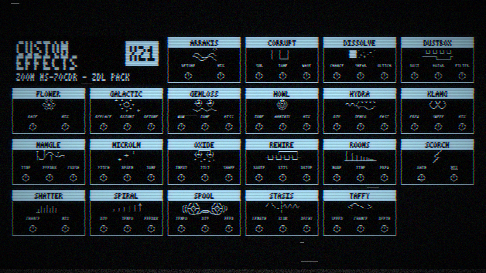</p>

**New here?** This is a pack of 22 extra effects plus a free browser-based
[Patch Editor](https://themanro.github.io/ZoomMultistompZDL/tools/patch_editor.html)
for adjusting knobs and arranging effects in your patches. On the original
MS-70CDR, you install the ready-made files from [dist/](dist/) over USB using
Zoom Effect Manager—no custom firmware reflash, coding, or compiling needed.
Back up your patches and effect list first. The Patch Editor edits patches;
Zoom Effect Manager installs the effects. See the [installation guide](docs/INSTALLING-ZDLS.md).

**Pedal compatibility:**

* **Tested:** original **MS-70CDR (firmware 2.10)**—custom effects and Patch Editor.
* **Confirmed by a user:** **MS-50G (firmware 3.10)**: NAM captures (full
  rate and Eco) and CabIR work ([#5](https://github.com/themanro/ZoomMultistompZDL/issues/5)).
  Patch Editor writes passed the opt-in write test on that pedal (save,
  backup and restore worked); still experimental.
* **Compatible family, awaiting confirmation:** **MS-60B, G1on, G1Xon, B1on
  and B1Xon**. Custom effects and Patch Editor compatibility on these models
  is awaiting confirmation from users.
* **Works with third-party tools:** **MS-100BT**. It has no USB MIDI, so
  Effect Manager and Patch Editor can't reach it; effects go on over Bluetooth
  with [lopezchau's MS-100BT tools](https://github.com/lopezchau/zoom-ms100bt-bluetooth)
  or [MS StompCtrl](https://github.com/1njected/ms-stompctrl). A user confirmed
  Shatter, Galactic, Microloom and Spool running
  ([#4](https://github.com/themanro/ZoomMultistompZDL/issues/4)); NAM and CabIR
  are untested there.
* **Not supported:** the **Plus models** (**MS-50G+, MS-60B+ and MS-70CDR+**)
  and the **Four series** (**G1/G1X Four, B1/B1X Four, A1/A1X Four**). They use
  Zoom's newer ZD2 effect format, so ZDL files don't load on them. See
  [Compatibility](#compatibility) below and the
  [pedal research notes](docs/pedal-research/README.md).
* **NAM on a Plus pedal:** use [nam2zoom](https://github.com/freelender/nam-to-zoom) by Aleksandar Vukasinovic instead
  (not this project). It packs 1-10 NAM captures into one MS Plus effect;
  tested on the MS-50G+ and MS-70CDR+, experimental on the MS-60B+.

## Custom NAM captures and cabinets (experimental)

Load your own amp captures ([NAM](https://www.neuralampmodeler.com/)) and
speaker cabinets (IRs) onto the pedal. Everything runs in your browser — no
compiler, nothing uploaded anywhere.

> **Beta — testers wanted.** Only tested on one MS-70CDR so far. Other models
> may hit `DSP full` sooner or crackle. Keep a backup of your patches, and read
> [If the pedal freezes](docs/NAM-LOADER.md#if-the-pedal-freezes) before you
> install anything. Please report what you find with the
> [NAM / Cab report form](https://github.com/themanro/ZoomMultistompZDL/issues/new?template=nam-cab-report.yml)
> — results from pedals other than the MS-70CDR are especially useful.

**How to use it**

1. Open the [NAM + Cab Loader](https://themanro.github.io/ZoomMultistompZDL/tools/nam_loader.html) (Patch Editor
   **Settings → Custom NAM captures**, with the local editor running).
2. **Amp:** drop in an A2 Lite `.nam` file, give it a short name, pick an
   icon and a slot, download the `.ZDL` and its thumbnail. Pick **Eco** or
   **Eco+** if you want it lighter on the DSP (see below). Pick a **Split**
   output to get the amp on one output and your clean guitar on the other.
3. **Cab:** drop in an IR `.wav` (44.1 or 48 kHz). The loader fits it to a
   small filter the pedal can afford and gives you a `.ZDL`; pick an icon per
   cab.
4. Install the files with Zoom Effect Manager. They appear in Patch Editor
   under the names you chose, as `NAM-<name>` and `CAB-<name>` on the pedal.

**Slots.** 216 amp slots and 216 cab slots, each with its own effect ID, so
you can keep as many installed side by side as the pedal's storage holds (each
file is ~30 KB for a capture, ~16 KB for a cab). Putting a new capture in a
used slot replaces the old one (patches that used that slot pick up the new
sound). Filenames encode the slot so they never collide: `NAM4smok.ZDL`,
`NAM150sm.ZDL`, `C01sm57.ZDL`, `C150sm5.ZDL`. Names must start with a letter.

**Your name and icon on the pedal.** Each file's pedal-screen picture shows the
name you typed and one of 21 icons (amp, cab, speaker, tube, mic, skull,
flame…); the Effect Manager thumbnail the loader gives you matches it.

<table>
<tr>
<td align="center"><br>A capture, <code>smokey</code>, amp icon</td>
<td align="center"><br>A cab, <code>4x12</code>, cabinet icon</td>
</tr>
</table>

**Knobs.**

| Effect | Knobs |
|---|---|
| NAM | Input, Output, Mix, Bass, Mid, Treb, Gate (noise gate; 0 = off) |
| NAM, split | Input, Output, **Dry** (the dry side's level: 50 = unchanged, -24 to +24 dB), Bass, Mid, Treb, Gate |
| CabIR | Mix, Level, Reso (low-end resonance), Pres (presence) |

**DSP budget.** The pedal refuses a patch (shows `DSP full`) once the summed
cost of its effects goes over about 225. Patch Editor now has a **DSP meter**
in the toolbar that adds up the chain for you (amber from 80%, red when the
pedal will refuse it).

| Effect | Declared cost | Notes |
|---|---|---|
| NAM, full rate | 194 | Best sound. Leaves room for one light effect (a drive, a cab). |
| NAM, Eco | 181 | Runs the model on 6 of every 8 samples. Within 0.3 dB of full rate below 3 kHz, a little less treble above. |
| NAM, Eco+ | 152 | Half rate, with a correction EQ the loader fits to each capture. Sounds noticeably worse than full rate, but leaves room for more effects. For amp-only captures into a cab. |
| CabIR | 10 | 32-tap filter + 6 EQ bands; fits next to any NAM. |

**What works.** A2 Lite captures only (the small standard NAM architecture).
Larger NAM models don't fit this DSP. Captures trained at 48 kHz work, but
retraining at 44.1 kHz (the pedal's rate) is closer to the real amp; we used
NAM ReTrainer by Alexander Lim ([Leemuzhko](https://github.com/Leemuzhko)) for
that. The cab fit follows his Hybrid IR idea
([HYBRID-IR](https://github.com/Leemuzhko/HYBRID-IR)): a short filter plus a few
EQ bands instead of a long IR, so a cab costs almost nothing.

**Your captures stay yours.** `.nam` files, fitted cabs and the `.ZDL` files
built from them are gitignored (`dist/NAM*`, `dist/C[0-9][0-9]*`, archives).
The templates in `tools/nam_template*/` and `tools/cab_template/` hold no
capture data — the loader only fills in the weights and the name.

See [the loader guide](docs/NAM-LOADER.md) for details,
[docs/NAM-RUNTIME-INVESTIGATION.md](docs/NAM-RUNTIME-INVESTIGATION.md) for how
the engine was made to fit, and
[src/hardware_probes/cab_ir/README.md](src/hardware_probes/cab_ir/README.md)
for the cab engine.

## Quickstart — edit your pedal from the browser

**[▶ Open the Patch Editor](https://themanro.github.io/ZoomMultistompZDL/tools/patch_editor.html)**

Plug the MS-70CDR in over USB, click **Connect**, and edit patches live — no
install, no clone, nothing sent anywhere (it is one self-contained HTML file and
your patch library lives in your own browser).

* **Opera or Edge.** Safari and Firefox do not implement Web MIDI; the editor
  will tell you if you are on one of them. **Chrome 152 is currently broken** —
  a Web MIDI *input* regression means output works, no dump ever arrives, and no
  error is raised. `tools/midi_check.html` confirms it in isolation.
* **Install effects without Effect Manager (MS-70CDR, new):** **Effects** in
  the toolbar lists this project's effects with the version on your pedal,
  and installs, updates or removes them over USB. It never touches Zoom's own
  effects, checks names and effect IDs against everything on the pedal,
  reads back every write, and can back up all the pedal's files first.
  Power-cycle the pedal after a change. Tested on firmware 2.10
  ([how it works](docs/EFFECT-INSTALL-PROTOCOL.md)).
* **Close Zoom Effect Manager first** — it holds the MIDI port. "The pedal did
  not respond" is usually this.
* Slots 1–3 respond to knob moves instantly. Slots 4–6 cannot be edited live by
  this hardware, so the editor applies those for you — see
  [docs/MIDI-PARAM-EDIT.md](docs/MIDI-PARAM-EDIT.md). Effects built before
  2026-09-10 also load with their knobs inert until nudged; **rebuild or
  reinstall from [dist/](dist/)** and that goes away.

<p align="center">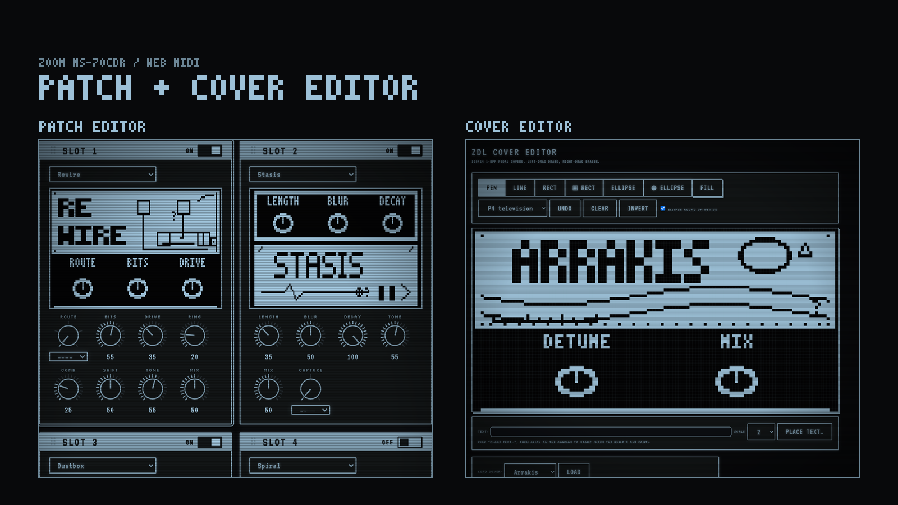</p>

**[▶ Open the Cover Editor](https://themanro.github.io/ZoomMultistompZDL/tools/cover_editor.html)**
— draw the 128×64 image an effect shows on the pedal's screen. Drawing, PNG/JSON
export and the device preview all work from the link above; the one-click
**Update ZDL** button additionally needs the local build server:

```bash
git clone https://github.com/themanro/ZoomMultistompZDL.git
cd ZoomMultistompZDL
python3 tools/serve_editor.py        # opens the editor, wires up "Update ZDL"
```

Loading new effects onto the pedal still goes through Zoom Effect Manager — the
browser can edit patches, but it cannot install effects.

## Custom effect pack

**September 14 display update:** all 22 effects now have individual laboratory-inspired
graphics, corrected LCD proportions, and shorter pedal labels. Mode controls show
names in PE and supported custom effects show short names on the pedal. Reinstall
the updated files from [dist/](dist/) to get the pedal artwork and labels; refresh
the Patch Editor for its UI changes. Existing patch values and effect IDs are preserved.
See the [display update notes](docs/EFFECT-DISPLAY-REFRESH.md) for details.

This fork ships a curated **library of 22 effects** — all grouped under the
Delay category, each with a custom on-device cover. Eighteen originals, three
Airwindows-derived ports (Galactic reverb, Oxide tape, Spool tape echo), and one
contributed effect (Dustbox).
Full knob layouts, caveats and sound demos are in
[CUSTOM_EFFECTS.md](CUSTOM_EFFECTS.md).

<table>
<tr>
<td align="center">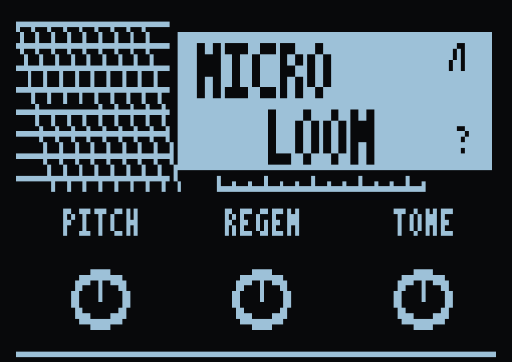</td>
<td align="center">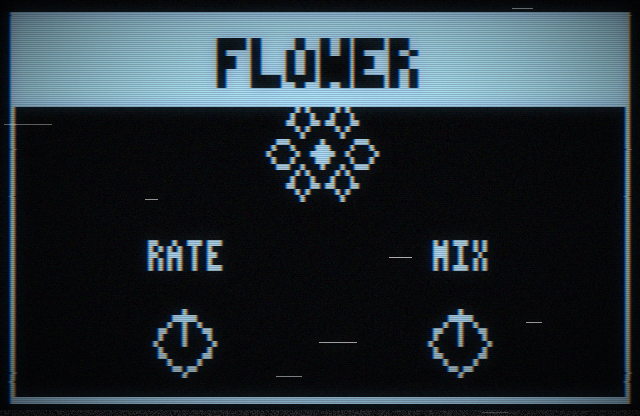</td>
<td align="center">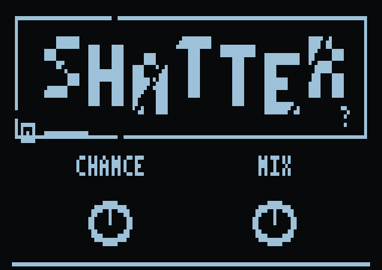</td>
<td align="center">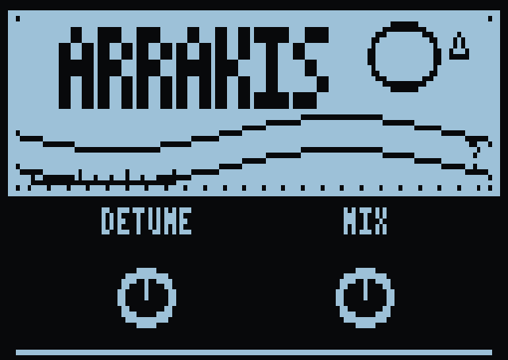</td>
</tr>
<tr>
<td align="center">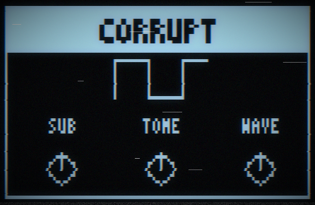</td>
<td align="center">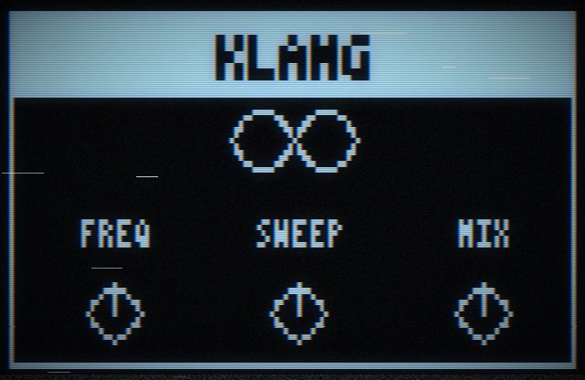</td>
<td align="center">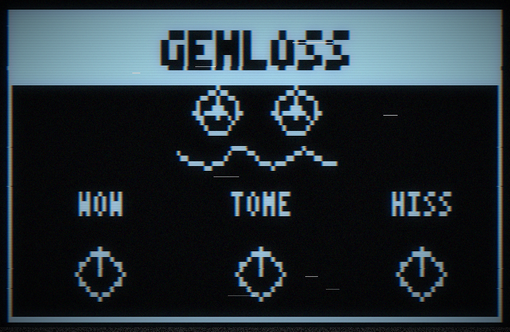</td>
<td align="center">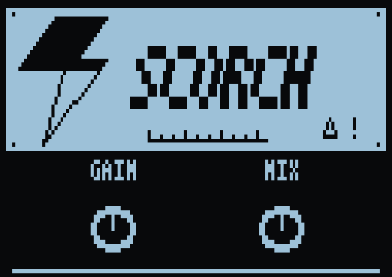</td>
</tr>
<tr>
<td align="center">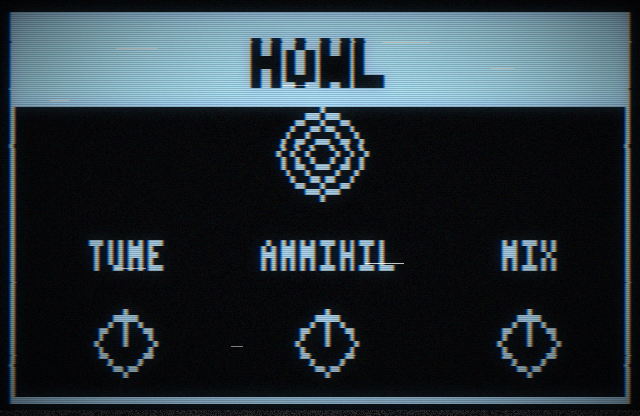</td>
<td align="center">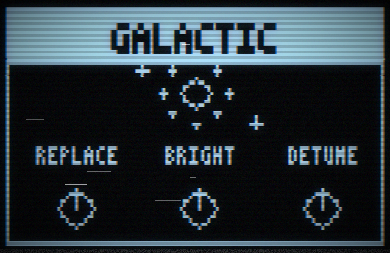</td>
<td align="center">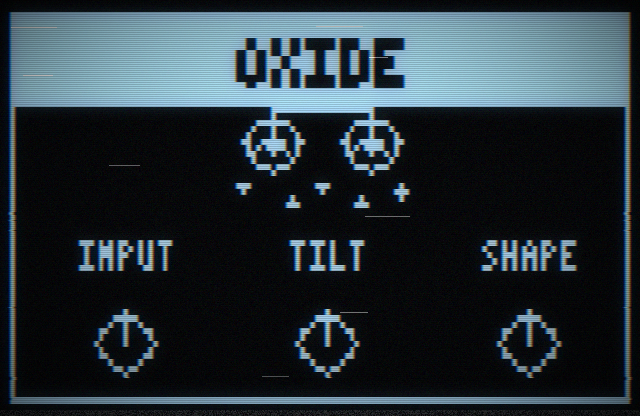</td>
<td align="center">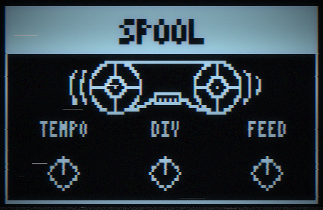</td>
</tr>
<tr>
<td align="center">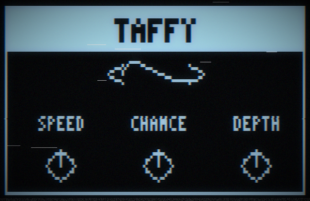</td>
<td align="center">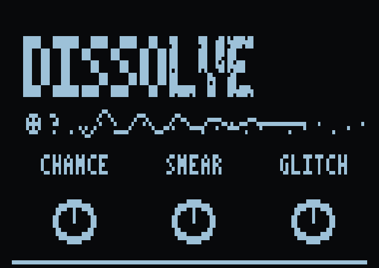</td>
<td align="center">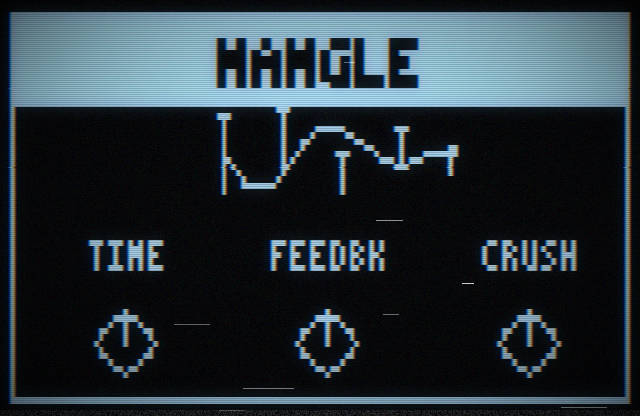</td>
<td align="center">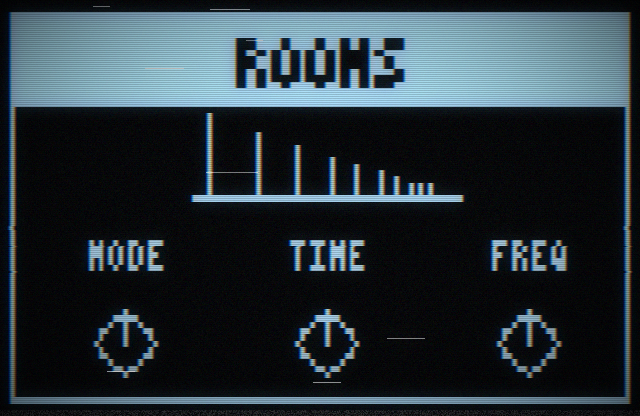</td>
</tr>
<tr>
<td align="center">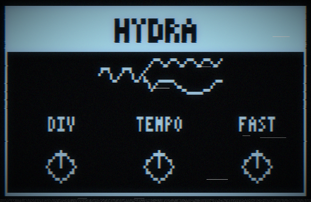</td>
<td align="center">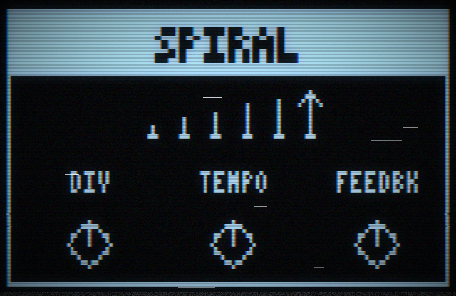</td>
<td align="center">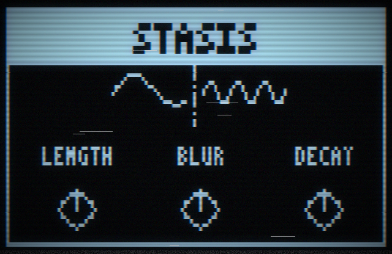</td>
<td align="center">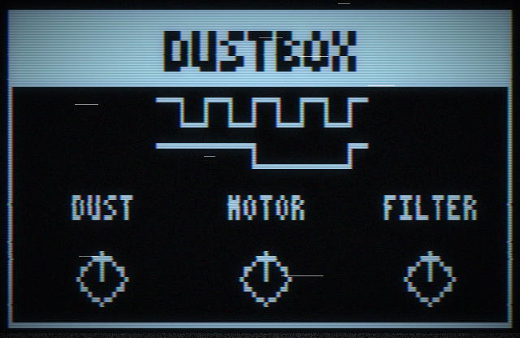</td>
</tr>
<tr>
<td align="center">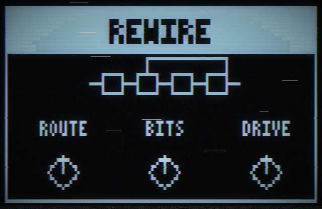</td>
<td align="center">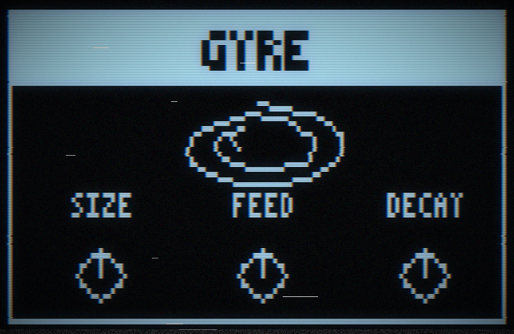</td>
<td></td>
<td></td>
</tr>
</table>

### What each one does

Knob lists are read from the shipped `dist/` binaries, so they match what the
pedal actually shows.

| Effect | Knobs | What it is |
|---|---|---|
| **Microlm** | Pitch, Regen, Tone, Mix | granular pitch-shimmer cloud; grains are pitched and fed back, so it builds rather than repeats |
| **Flower** | Rate, Mix | Korg-style random sample-and-hold step filter — the "Digital Bath" sound |
| **Shatter** | Chance, Mix | stutter / beat-repeat glitch for drums |
| **Arrakis** | Detune, Mix | Dune-style detuned sub-octave drone, two subs beating against each other |
| **Corrupt** | Sub, Tone, Wave, Mix | EQD Data Corrupter-style PLL square synth with tracked sub and divided harmony |
| **Klang** | Freq, Sweep, Mix | swept-carrier ring modulator — sirens, dive bombs, clangorous metal |
| **GenLoss** | Wow, Tone, Hiss, Mix | tape/VHS generation loss: wow, head-bump tone shift, hiss |
| **Scorch** | Gain, Mix | aggressive high-gain amp with a cab-style filter (cab baked as biquads, not an FIR) |
| **Howl** | Tune, Annihil, Mix | DBA Total Sonic Annihilation-style feedback loop that self-oscillates on demand |
| **Taffy** | Speed, Chance, Depth, Glide, Mix | Red Panda Tensor-style tape warp — reverse, stop, double-speed, random slips |
| **Dissolve** | Chance, Smear, Glitch, Mix | OBNE Parting-style glitch delay dissolving into a reverb wash |
| **Mangle** | Time, Feedbk, Crush, Tremolo, Pitch, Mix | delay with three blendable per-repeat mutations; all three at 0 is a clean delay |
| **Rooms** | Mode, Time, Freq, Depth, Mix | DBA Rooms-inspired multi-mode reverb: ROOM / DIGIT / PEAK / GATE / WAVE / GONG. Freq and Depth are re-purposed per mode |
| **Hydra** | Div, Tempo, Fast, Slow, Tone, Mix | **tempo-locked** double-time and half-time ghost layers on one delay ring; built for drums |
| **Spiral** | Div, Tempo, Feedbk, Rise, Glide, Span, Tone, Mix | **tempo-locked** delay whose repeats climb or sink in pitch, compounding every repeat |
| **Stasis** | Length, Blur, Decay, Tone, Mix, Capture | footswitch-triggered freeze — the note you just played is held while you play over it. Capture selects stomp or explicit capture |
| **Dustbox** | Dust, Motor, Filter, Power | DOD FX33 Buzz Box-style fuzz with a flip-flop sub-octave — contributed, MIT |
| **Rewire** | Route, Bits, Drive, Ring, Comb, Shift, Tone, Mix | five lo-fi blocks — crush, drive, ring mod, comb, frequency shift — in a chain you can **reorder**. Shift is a true single-sideband shifter (−51 dB image), so it moves partials off the harmonic series |
| **Gyre** | Size, Feed, Decay, Rise, Glide, Span, Tone, Mix | granular feedback loop; two grains half a window apart with complementary windows, so the loop is unity-throughput and holds instead of running away |
| **Galactic** | Replace, Bright, Detune, Bigness, Mix | lush Airwindows reverb, wet path boosted for pedal levels |
| **Oxide** | Input, Tilt, Shape, Flutter, FlutSpd, Bias, HeadBmp, Output, Mix | Airwindows ToTape9 saturation. Input is a 0–4× drive compensated above unity, Tilt the Dolby-style encode/decode balance, Bias an asymmetric even-harmonic drive |
| **Spool** | Tempo, Div, Feed, Flutter, Wow, Wear, Drive, Spring, Mix | tempo-locked tape echo with flutter, wow, head wear, drive and a spring tail. Feed reaches self-oscillation above ~90 |

> Every effect ends with a **Mix** knob (dry/wet, default 50), so levels and
> controls are consistent across the pack — an effect is audible as soon as it is
> selected. Dustbox is the exception; its fourth knob is Power.
>
> The pedal can't hold or run all 22 at once (storage + DSP limits) — install a
> subset, back up first, and flash one at a time. Run heavy effects (Microlm,
> Galactic, Spool) one per patch.

## Matujuice effects pack (included)

Twelve more effects, made by **Luca Matturro**
([matujuice](https://github.com/matujuice)) on this project's toolchain and
included here unmodified under his MIT licence:
[zoom-ms-zdl-effects-pack](https://github.com/matujuice/zoom-ms-zdl-effects-pack)
release v1.5. The files in [dist/](dist/) match that release's checksums.
v1.5 has its own Tempo knobs, so it runs on stock firmware; later releases
(v1.6+) take their tempo from [MIDISTOMP](https://github.com/matujuice/zoom-ms-midistomp)
and are on his page. His full guide and licence are in
[dist/matujuice/](dist/matujuice/README.md); in Patch Editor they are listed
under his name. Screens below are his artwork, as the pedal shows it.

<table>
<tr>
<td align="center"></td>
<td align="center"></td>
<td align="center"></td>
<td align="center"></td>
</tr>
<tr>
<td align="center"></td>
<td align="center"></td>
<td align="center"></td>
<td align="center"></td>
</tr>
<tr>
<td align="center"></td>
<td align="center"></td>
<td align="center"></td>
<td align="center"></td>
</tr>
</table>

| Effect | What it does |
|---|---|
| **WaveFold** | Wavefolder (a Buchla 259 fold curve). |
| **DualShft** | Tempo-synced dual pitch shifter. |
| **Choral** | Pitch-tracked choir. |
| **EuGate** | Euclidean rhythm gate. |
| **DubSiren** | Dub siren with tape echo. |
| **SGNL** | Broken digital line: glitches, dropouts, codec damage. |
| **Scrub** | Scrub through the last seconds, freeze where you stop. |
| **GridDly** | One tempo-synced delay with six engines. |
| **SyncEQ** | EQ that passes the bar sync on to the effects after it. |
| **Breather** | Tempo-synced pump with a reverb. |
| **DirtBox** | Distortion box for acid lines: seven classic pedal models, EQ, noise reducer. |
| **Sweep** | Phaser, flanger and filter in one. |

Made for synths and drum machines as much as guitar. Their IDs are 480 and
485-496. If you installed a very early Howl build (ID 480), reinstall Howl from
dist/ before adding DualShft.

## A looper and live screens

These run on the stock MS-70CDR firmware and are in [dist/](dist/), tested on
the pedal (2026-10-20). Their screens need firmware 2.10;
on any other firmware they keep working as audio effects, and the screen
effects simply pass the sound through. The live screens use the whole display:
their knobs are on the pedal's knob pages, as usual.

<table>
<tr>
<td align="center"></td>
<td align="center"></td>
<td align="center"></td>
</tr>
<tr>
<td align="center"></td>
<td align="center"></td>
</tr>
</table>

| Effect | What it does |
|---|---|
| **[Loop](src/custom/loop/README.md)** | A looper on the footswitch: record, play, overdub, stop, clear, with undo/redo. About 5 s, or about 23 s in experimental Long mode. Tempo quantize (set the BPM and beats per bar; the loop snaps to whole bars) with a click. Its screen shows the state, the time or bar and beat, and the loop's waveform. |
| **Scope** | A live oscilloscope of your signal, full screen: waveform, or XY (left against right). |
| **Spectrum** | A live spectrum analyzer, 40 Hz – 16 kHz, with peak hold, full screen. |
| **Ring** | A rotating ring that follows the signal, full screen. |
| **Skull** | A shaded 3D skull that reacts to your playing, idles with animations when you stop, and explodes at the loudest peaks. |

Loop's Long mode (extra RAM) is still experimental; see its
[README](src/custom/loop/README.md). How an effect can animate its own screen is in
[animated-covers.md](docs/pedal-research/animated-covers.md), built on Alexander
Lim's ([Leemuzhko](https://github.com/Leemuzhko/ZOOM_development)) firmware notes.

## Download Effects

The ready-to-load effects are in [dist/](dist/). Point Zoom Effect Manager at
that folder, or download individual `.ZDL` files from it. You do not need the
build toolchain unless you want to modify or rebuild effects.

## Install With Zoom Effect Manager

Use [Zoom Effect Manager](https://zoomeffectmanager.com/en/download/) 2.3.3 or
newer.

1. Open Zoom Effect Manager, connect your pedal, then open `Settings`.
2. Choose `Read Effects from folder` and select this repo's [dist/](dist/)
   folder.


3. In the effect browser, enable `Effects from devices` and `From Folder`.
4. Add the desired effects to the device and write them with Zoom Effect
   Manager.


Back up your current effect list before writing. Experimental builds can
freeze a pedal until power-cycled.

**Effects must be installed with Zoom Effect Manager first.** The patch editor
only *references* effects by id — it cannot install them. Its dropdown is the
full catalogue from every MS/G1/B1 model, not the subset on your pedal, so
selecting something Effect Manager has never written leaves that slot blank. The
editor warns when you pick an effect it has not seen in any of your patches, and
tells you if the pedal drops one after a write.

**If the effect browser says "No data to display, check filters":** step 3 is
not optional -- choosing the folder only tells Effect Manager where to look, and
the browser's `From Folder` source has to be ticked separately. Connect the
pedal before launching, and check no category filter is set (everything here is
in **Delay**). If it still shows nothing, verify the files really are ZDLs and
not saved HTML pages -- see
[docs/INSTALLING-ZDLS.md](docs/INSTALLING-ZDLS.md#check-that-your-download-is-real-windows-especially).

**Gotchas learned the hard way:**

- Effect Manager does **not replace** an installed effect with the same fxid —
  remove the old one from the device, re-read the folder, then add the new one.
- Effect Manager reads custom **thumbnails** from matching PNG files beside the
  ZDLs (for example, `Rooms.ZDL` and `Rooms.png`). Keep both files together and
  restart Effect Manager after updating them. These thumbnails use the same
  artwork as the pedal. PNG files are for the manager; they are not installed
  on the pedal.
- `FS.bin size mismatch` when writing = too many effects installed (storage
  overflow). `DSP full` = the per-patch processing budget is blown — run heavy
  effects (Microloom, Galactic, Spool) one per patch.
- **If the pedal freezes on the boot screen** (a patch references a bad
  effect): power off, hold the **Parameter 1 (leftmost) knob pressed in**,
  power on → `All INITIALIZE` → press the footswitch. Patches reset to
  factory, but effect binaries stay installed — then remove the bad one.

More detailed install notes live in [docs/INSTALLING-ZDLS.md](docs/INSTALLING-ZDLS.md).

## Compatibility

| Device family | Status |
|---|---|
| Zoom MS-70CDR firmware 2.10 | Primary hardware target; the release effects are developed and play-tested against this pedal. |
| Zoom MS-50G firmware 3.10 | NAM (full rate and Eco) and CabIR confirmed by a user ([#5](https://github.com/themanro/ZoomMultistompZDL/issues/5)). Patch Editor writes passed the opt-in write test on that pedal; still experimental. Same DSP headroom as the MS-70CDR. |
| Other ZDL-based Zoom pedals (MS-60B, G1on/G1Xon, B1on/B1Xon) | Compatible family, awaiting confirmation — hardware reports welcome. |
| Zoom MS-100BT | Custom effects confirmed by a user, installed over Bluetooth with third-party tools ([#4](https://github.com/themanro/ZoomMultistompZDL/issues/4)). No USB MIDI, so no Effect Manager or Patch Editor. NAM/CabIR untested. |
| Original G3/G3X, G5, B3 and A3 | Share the ZFX-IV DSP family, but this project's custom effects and Patch Editor are not currently supported or validated on them. |
| Newer Zoom ZD2-based pedals (Plus models; G1/G1X, B1/B1X and A1/A1X Four; G3n, G5n, B3n, AC-2/AC-3) | Not supported by these ZDL builds. ZD2 and ZDL effects are not interchangeable ([Zoom Firmware Editor](https://github.com/Barsik-Barbosik/Zoom-Firmware-Editor) lists which pedal uses which; the A1 Four is assumed ZD2 like the rest of the Four series). |

**Does sharing the processor mean my pedal can run these effects?** It makes
porting worth investigating, but does not establish compatibility. Zoom's
**ZFX-IV** name identifies a DSP family; it does not establish identical chip
revisions, memory or clock speeds across every model. Installing custom effects
also depends on the pedal's firmware and effect format, while Patch Editor
support depends on its MIDI messages and patch layout.

Sources for the shared DSP family:

* **G3/G3X, G5, B3 and A3:** Zoom explicitly identifies ZFX-IV in its
  [2015 effects catalogue](https://zoomrussia.ru/manuals/FX_Catalog_E.pdf).
  The [G3/G3X operation manual](https://zoomcorp.com/media/documents/G3_G3X_operationManual_English.pdf)
  also confirms it. These are the original models, not the later **G3n/G3Xn,
  G5n or B3n**.
* **MS-50G and MS-60B:** a community
  [motherboard comparison during a rehousing](https://www.reddit.com/r/zoommultistomp/comments/mggluh/rehoused_an_ms50g_into_a_black_ms60b/)
  reports ZFX-IV markings on both boards. This is hardware evidence, not a
  confirmation that our effects or editor have been tested on both pedals.

**The "+" models (MS-50G+, MS-60B+, MS-70CDR+) use ZD2, not ZDL**, so nothing
in `dist/` loads on them. Custom ZD2 effects are now demonstrated on the
MS-70CDR+ by [Stomphacks](https://github.com/thammer/stomphacks), including a
C-to-ZD2 build pipeline. Our pack and Patch Editor have not been ported.
For NAM captures on a "+" pedal, [nam2zoom](https://github.com/freelender/nam-to-zoom) works today (MS-50G+ and MS-70CDR+
tested, MS-60B+ experimental).
See [ZD2 research notes](docs/ZD2-PORT-NOTES.md) for the evidence, remaining
memory/interface questions, and proposed next steps.

**Step-by-step guide: [docs/PROBING-A-NEW-PEDAL.md](docs/PROBING-A-NEW-PEDAL.md).**
Two things anyone with a "+" pedal can check, neither of which risks the
hardware:

* `python3 build/inspect_zd2.py Effect.ZD2` — reports entropy and structure.
  Uneven per-block entropy means plain code; flat and high everywhere means
  encrypted or compressed. Validated against a known-plain ZDL, random bytes and
  a gzip stream.
* Open the patch editor and click Connect. It reads the identity reply, adopts
  the device id so dumps are addressed correctly, and switches to READ-ONLY on
  any model but the MS-70CDR — every byte offset here was mapped against that
  one pedal, so writing elsewhere would scramble patches. If a "+" pedal answers
  `Reload bank` with a patch dump, that alone is worth reporting.

A working ZD2 build and USB-MIDI installation path has been demonstrated by
Stomphacks on the MS-70CDR+. Other models and our effects still require their
own validation; readable ELF data alone does not prove install compatibility.

## What We Learned (field notes)

Hard-won findings from getting these effects stable on real hardware. The
deep versions live in [docs/](docs/) and [build/ABI.md](build/ABI.md).

### The two confirmed freeze classes

1. **Code→data relocations.** Any `static` array referenced from the audio
   function (even `static const float[]`) forces a relocation and freezes the
   pedal at load. Bake tables as `#define` scalar literals or unrolled
   macro sums instead — they compile to immediates. A clean build prints
   `.fardata: 0 bytes` and `Applied 0 .obj relocations`; anything else is a
   red flag. (This froze Spool until its 64-tap FIR was unrolled.)
2. **Unresolved runtime helpers.** Any float division, integer `/` or `%`,
   or math-lib call (`sinf`, `powf`, …) emits a `__c6xabi_*` helper the
   loader can't resolve — the branch goes to address 0. Use polynomial
   sin/cos, Newton-iteration reciprocals, and bit-mask tricks instead of
   modulo. See [docs/SAFE-DSP-RULES.md](docs/SAFE-DSP-RULES.md).

### Memory and CPU budgets

- The host gives each effect instance a large state arena via `ctx[3]`,
  hardware-probed to **≥705,536 bytes** — Lush-class (512 KB) and Spool-class
  (545 KB) states load fine. Always bounds-check the descriptor and clear big
  buffers lazily in chunks.
- **DSP cost** is a float the effect declares in its descriptor (stock
  effects declare 11.6–128). The pedal sums it across the patch and refuses
  the patch with `DSP full` above a limit measured at 224.4–228.4. The linker
  defaults to 20.0; heavy effects set an honest value (`LinkerConfig.dsp_cost`)
  — NAM declares 194/177, CabIR 10. Declaring too little lets the firmware
  green-light a chain the DSP can't run: crackles, or a hang at patch load.
- **File size cap:** a ZDL over ~32 KB freezes the pedal at boot (largest
  proven: 32,126 bytes file, 29,576 bytes code+data; 30,336 froze).
  [build/zdl_size_guard.py](build/zdl_size_guard.py) enforces it.

### Parameters are hostile

- The proven knob path delivers **normalized 0..1 floats** (an earlier ×7.14
  scaling assumption made every knob saturate at ~14% travel).
- **Saved parameters now initialize at patch load.** The former freeze came
  from absolute handler call targets that lacked relocation records; the linker
  now emits PC-relative calls. All 22 release effects enable the corrected init.
  MatProb and Rooms are hardware-confirmed in all six slots, across patch changes
  and power cycles with the editor disconnected. The remaining effects are built
  and statically checked, with hardware listening still pending. See
  [docs/PARAM-INIT-INVESTIGATION.md](docs/PARAM-INIT-INVESTIGATION.md).
- The editor retains live-parameter replay for slots 1–3 for compatibility with
  older installed binaries. It cannot identify the installed build from its
  effect ID alone. Slots 4–6 still lack live `0x31` edits; initialization and
  editor-side update behavior are separate concerns.
- **Refocusing an effect in the chain UI clobbers its param block with
  garbage** until wiggled. The fix (piloted in Howl v3) is an edit-driven
  knob latch: a real knob turn changes one slot at a time, so bulk rewrites
  are detected and ignored, and the effect keeps sounding as dialed.
- Up to 9 params work (3 pages × 3), image shows the first three knobs;
  the multi-knob synthesized-handler path is hardware-proven.

### Feedback DSP on this box

- Never feed a resonant filter back into itself — loop gain crosses unity
  almost everywhere. Use a pole-radius-controlled resonator (radius < 1 is
  unconditionally stable); that's how Howl works.
- A cubic soft-clip has **1.5× gain at small signal** — inside a feedback
  loop that multiplies loop gain and self-oscillates. Use a unity-slope
  clipper (`x − x³/6.75`) in loops. (Caught twice: Scorch's output, then
  Dissolve's smear loop.)

### Covers, screens, thumbnails

- The on-device cover is the **full 128×64**, 1-bpp, column-major in eight
  8-row blocks, run-length encoded. The firmware paints live 20×15 knob-value
  boxes on top at coordinates the ZDL declares — so draw labeled dials under
  them, stock-style ([build/decode_picture.py](build/decode_picture.py)
  decodes any ZDL's cover; ~130 stock covers were decoded to learn this).
- The LCD pixels are ~1.3× taller than wide: pre-compress artwork vertically
  or circles render as tall ellipses.
- Hand-drawn covers: [tools/cover_editor.html](tools/cover_editor.html) is a
  self-contained pixel editor with a device-aspect preview; exported JSON in
  `src/airwindows/common/covers/` overrides the generated cover at build time.

### Identity and packaging

- ZDL basenames must be **≤ 8 characters** and unique after truncation, or
  effect identities collide and the pedal freezes at boot. The effect DB build
  refuses a `dist/` that breaks this.
- There is **no sort field** in the header — on-device browse order tracks
  fxid. This pack uses 450+ to avoid stock collisions.
- gid ↔ category must match the exported symbol prefix
  (1=DYN, 2=FLT, 3=DRV, 6=CHO/MOD, 8=DLY, 9=REV); everything here is gid 8
  (`Fx_DLY_*`) so the pack lives together in the least crowded menu.
- **Reserved effect IDs** (Delay group; FXIDs go up to 1023): this pack
  403–499 and 914 (Spool), NAM captures 900–907, 950–957 and 500–699, CabIR
  cabs 930–945 and 700–899. Other projects building effects for these pedals:
  please avoid them. 409 is retired: Spool and TEcho4 (another collection)
  both used it, and swapping them froze a pedal at boot. An effect is
  identified by its group and ID together: Zoom's own effects reuse IDs across
  groups (DELAY, COMP, LINESEL, TREMOLO and HDHALL are all ID 8), and Skull
  (Delay 416) runs beside SpaceHole (Reverb 416). So a new Delay effect needs
  an ID no other collection uses in the Delay group
  ([repeat98's registry](https://github.com/repeat98/ZoomMultistompZDL/blob/main/docs/FXID-REGISTRY.md)
  lists them).

## Build Your Own Effects

Start from a small effect in [src/custom/](src/custom/) (e.g. `reel` or
`klang`). Copy the directory, give the effect a new name and an unused `fxid`
in `manifest_pedal.json`, update the C audio function and `build.py`, then add
it to [build_all.py](build_all.py).

Keep the first hardware test boring: `audio_nop: true` or tiny pass-through
DSP, no static arrays, no divides, magic shuttle preserved. The safe path is
[docs/SAFE-DSP-RULES.md](docs/SAFE-DSP-RULES.md); effect directory conventions
are in [src/airwindows/README.md](src/airwindows/README.md).

## Build From Source

Zoom's and TI's files (stock effects, firmware, the stock handler blobs the
linker uses, TI's manuals) are not in this repository; see
[STOCK-FILES.md](docs/STOCK-FILES.md) for what a build needs locally.

Building requires Python 3.10+ and the TI C6000 Code Generation Tools
(v8.5.0). Installing prebuilt effects from [dist/](dist/) does not.

The build scripts expect the TI compiler here (edit `TI_ROOT` in the
per-effect `build.py` if yours differs):

```text
/Applications/ti/ti-cgt-c6000_8.5.0.LTS
```

```bash
python3 -B build_all.py            # all 22 release effects, with load initialization -> dist/
python3 -B build_all.py taffy      # one effect
python3 -B build_all.py --all      # + diagnostic/probe builds (-> build/probes/)
```

`build_all.py` also re-extracts the patch editor's inline effect database at the
end, so the editor cannot go stale against `dist/`. It silently did, twice.

Desktop listening previews for the originals (no compiler, no pedal) are in
[tools/audio_preview/README.md](tools/audio_preview/README.md).

### Testing without a pedal

There is a headless C674x emulator (Ziddle) that runs these ZDLs, plus a test rig
in [tools/emulator/](tools/emulator/) that reports whether `_init` completes and
whether params materialized. It is authoritative about instruction semantics and
**cannot see firmware readiness** — it passed four `_init` builds that froze the
pedal. Setup and limits: [docs/EMULATOR-TESTING.md](docs/EMULATOR-TESTING.md).

`build/disassemble_zdl.py` disassembles any ZDL, ours or one of Zoom's ~830 stock
effects in `stock_zdls/` (kept locally: [STOCK-FILES.md](docs/STOCK-FILES.md)). Diffing a generated handler against the stock
equivalent has been the most productive debugging tool in the project.

## Technical Notes

This repo builds loadable Zoom `.ZDL` effects without Zoom's unreleased SDK:

| Path | Purpose |
|---|---|
| [build/linker.py](build/linker.py) | Static linker: TI C6000 `.obj` → complete Zoom `.ZDL` (header, descriptor table, image info, edit handlers). |
| [build/decode_picture.py](build/decode_picture.py) | Decode any ZDL's on-device cover + knob-box layout back to pixels/PNG. |
| [tools/cover_editor.html](tools/cover_editor.html) | Browser pixel editor for covers, with device-aspect preview. |
| [tools/patch_editor.html](tools/patch_editor.html) | Web MIDI patch editor that sees **custom effects** (names/params extracted from the ZDLs; other editors only know stock). Serve the repo root over `http://localhost` and open it. |
| [tools/editor.html](tools/editor.html) | The same editor in Modwerk's design ([open](https://themanro.github.io/ZoomMultistompZDL/tools/editor.html)): it loads `patch_editor.html` and runs it under its own layout and styles, so features and fixes land in both. In testing; the classic editor stays the default. |
| [build/extract_effect_db.py](build/extract_effect_db.py) | Regenerate the patch editor's effect database from dist/ + stock ZDLs. |
| [src/custom/](src/custom/) | Original effects. |
| [src/airwindows/](src/airwindows/) | Airwindows-derived ports. |
| [src/hardware_probes/](src/hardware_probes/) | Diagnostic ZDLs used to map the pedal runtime ABI. |
| [dist/](dist/) | Release `.ZDL` files; never probes. |
| `stock_zdls/` | Zoom's stock effects, used for comparison and layout ground truth. Kept locally, not in the repository ([STOCK-FILES.md](docs/STOCK-FILES.md)). |

Known runtime map for custom ZDLs:

| Field | Meaning |
|---:|---|
| `ctx[1]` | parameter float table |
| `ctx[4]` | dry/guitar input buffer |
| `ctx[5]` | current effect buffer, 8 left samples then 8 right samples |
| `ctx[6]` | output accumulator for effects that add instead of processing in place |
| `ctx[11]` / `ctx[12]` | magic shuttle; preserve every audio call |
| `ctx[2] + 0x10` / `ctx[2] + 0x18` | small persistent per-instance state blocks |
| `ctx[3][0..2]` | large per-instance descriptor: base, end, byte span (≥705,536 B) |

## Repository Layout

```text
ZoomMultistompZDL/
├── README.md
├── build/                 linker, ELF/ZDL helpers, cover decoder, handler blobs
├── docs/                  install notes, ABI status, and porting guidance
├── dist/                  release ZDLs to load in Zoom Effect Manager
├── graphics/              gallery renders of the on-device covers
├── tools/                 cover editor + desktop audio preview
├── src/custom/            original effects
├── src/airwindows/        Airwindows-derived ports + shared helpers
├── src/hardware_probes/   diagnostic ZDLs for runtime ABI experiments
├── stock_zdls/            tracked stock ZDL corpus used for comparison
└── build_all.py           release/probe build entrypoint
```

Several research references are useful locally but intentionally git-ignored:
`airwindows-ref/`, `zoom-fx-modding-ref/`, `ZoomPedalFun-main/`. If you clone
them beside the repo, treat them as read-only references.

## Documentation

| Doc | What it covers |
|---|---|
| [CHANGELOG.md](CHANGELOG.md) | What changed, newest first. |
| [HANDOFF.md](HANDOFF.md) | **Start here** if you are picking this project up: current state, how to test, and what has already been ruled out. |
| [docs/PARAM-INIT-INVESTIGATION.md](docs/PARAM-INIT-INVESTIGATION.md) | How the param-materialization bug was actually diagnosed — unrelocated absolute call targets — and the firmware tracing behind it. |
| [docs/RELEASE-INIT-AUDIT.md](docs/RELEASE-INIT-AUDIT.md) | Rolling the fix out across all 22 effects, plus four follow-up defects found in the audit. |
| [docs/INIT-MATERIALIZATION.md](docs/INIT-MATERIALIZATION.md) | Investigation record for the same bug, including four `_init` attempts that froze the pedal and the reasoning that went wrong. |
| [docs/EMULATOR-TESTING.md](docs/EMULATOR-TESTING.md) | Running ZDLs headlessly against an emulated C674x, and the firmware behaviour it cannot see. |
| [docs/EDIT-HANDLER-ABI.md](docs/EDIT-HANDLER-ABI.md) | How generated edit handlers work, and why they delegate to `ctx[7]`. |
| [docs/MIDI-PARAM-EDIT.md](docs/MIDI-PARAM-EDIT.md) | SysEx protocol for live param edits; the slots 1–3 rule. |
| [docs/LOADER-SAFETY.md](docs/LOADER-SAFETY.md) | Catalogued freeze causes mapped to their triggers. |
| [docs/INSTALLING-ZDLS.md](docs/INSTALLING-ZDLS.md) | Step-by-step Zoom Effect Manager folder install. |
| [docs/SAFE-DSP-RULES.md](docs/SAFE-DSP-RULES.md) | Pedal-safe DSP/linking constraints learned from hardware failures. |
| [docs/ZDL-REVERSE-ENGINEERING-STATUS.md](docs/ZDL-REVERSE-ENGINEERING-STATUS.md) | Current map of the ZDL wrapper, runtime ABI, and known state fields. |
| [docs/STATE-ABI-PROGRESS.md](docs/STATE-ABI-PROGRESS.md) | Hardware-proven state/edit-handler findings. |
| [docs/AIRWINDOWS-EXACT-PORTS.md](docs/AIRWINDOWS-EXACT-PORTS.md) | Rules for what can and cannot be called a 1:1 Airwindows port. |
| [docs/CONTRIBUTING.md](docs/CONTRIBUTING.md) | Hardware-test asks and contribution notes. |
| [build/ABI.md](build/ABI.md) | Low-level linker/runtime ABI reference for developers. |
| [docs/TI-PDF-NOTES.md](docs/TI-PDF-NOTES.md) + TI PDFs | TI C6000 toolchain references. |
| [docs/pedal-research/](docs/pedal-research/README.md) | What's known about every other Zoom pedal people ask about: effect format, install path, IDs, risks and the next safe experiment. |
| [docs/PROBING-A-NEW-PEDAL.md](docs/PROBING-A-NEW-PEDAL.md) | How to find out whether a pedal this project has never seen — the `+` models especially — is analysable, talks MIDI, and hands over patches. |

## Related projects

| Project | What it is |
|---|---|
| [MS StompCtrl](https://github.com/1njected/ms-stompctrl) | Browser-only patch editor and backup tool for the **MS-100BT**, over Bluetooth in Chrome ([open it](https://1njected.github.io/ms-stompctrl/)). Reads, edits and writes patches, backs up the bank, and installs `.ZDL` files. A user has run four of this repo's effects on the MS-100BT ([#4](https://github.com/themanro/ZoomMultistompZDL/issues/4)); back up first and report what you find. MIT. |
| [MIDISTOMP](https://github.com/matujuice/zoom-ms-midistomp) | Custom firmware for the original MultiStomps: MIDI Program Change, CC control of every knob, MIDI clock with Start/Stop, a tap-tempo screen and footswitch-hold options. Installed by flashing a modified Zoom updater (riskier than an Effect Manager install). Tested on an MS-60B running MS-50G 3.10; MS-50G and MS-70CDR untested. MIT. |
| [Matujuice ZDL effects pack](https://github.com/matujuice/zoom-ms-zdl-effects-pack) | Luca Matturro's custom effects, built on this toolchain, made for synths and drum machines. v1.5 is [included here](#matujuice-effects-pack-included); v1.6 and later follow MIDISTOMP's tempo (120 BPM on stock firmware). MIT. |
| [repeat98/ZoomMultistompZDL](https://github.com/repeat98/ZoomMultistompZDL) | The upstream ZDL toolchain this fork started from. |
| [nam2zoom](https://github.com/freelender/nam-to-zoom) | NAM captures on the **Plus** pedals (MS-50G+, MS-70CDR+; MS-60B+ experimental): one to ten captures in one "N2Z Bank" effect (Model, Bass, Mid, Treble, Vol, Input, Mix), on a smaller 14-layer network, with an optional cab IR. Windows app; macOS in preview. By Aleksandar Vukasinovic, MIT. |
| [Leemuzhko/ZOOM_development](https://github.com/Leemuzhko/ZOOM_development) | Alexander Lim's SDK notes and hardware results for the MS-70CDR. Much here rests on them: how an effect draws its own screen (the live screens and the zvis kit), the pedal's file-size cap and DSP limit, and linker pitfalls. The repo has no licence, so its findings are used here with credit, not its code. |
| [Leemuzhko/HYBRID-IR](https://github.com/Leemuzhko/HYBRID-IR) | Alexander Lim's short-filter-plus-EQ cab idea behind CabIR. |
| [Ziddle](https://berbasoft.com/ziddle/) | C674x emulator used to test ZDLs before they touch hardware. |
| [r/zoommultistomp](https://www.reddit.com/r/zoommultistomp/) | Community subreddit for the MultiStomp pedals. |

## Contributing

Hardware reports are gold. When testing a ZDL, please include:

| Item | Example |
|---|---|
| Pedal model and firmware | `MS-70CDR firmware 2.10` |
| ZDL filename and commit | `Taffy.ZDL @ 864d85d` |
| Load result | boots, freezes on startup, freezes on unbypass |
| Audio result | bypass, dry passthrough, effect works, high-pitched tone |
| Parameter behavior | Speed works 0..100, Chance saturates, page 2 knob missing |

Open an issue or PR with findings. Keep experimental claims precise: "boots on
my MS-70CDR" is more useful than "works everywhere."

## License

Everything in this repository is MIT; see [LICENSE](LICENSE):

- **This fork's own work** (the custom effects in `src/custom/`, the browser
  tools in `tools/`, the notes in `docs/`, the cover art in `graphics/`):
  MIT, Roman Rusinov.
- **The upstream toolchain** this is forked from,
  [repeat98/ZoomMultistompZDL](https://github.com/repeat98/ZoomMultistompZDL)
  (the linker, the ZDL tools, the ABI and reverse-engineering notes, the first
  effects): MIT, Jannik Assfalg.
- **Airwindows DSP** in `src/airwindows/`: MIT, Chris Johnson/Airwindows,
  under its own terms.
- **The Matujuice effects** in `dist/` (Breather, Choral, DirtBox, DualShft,
  DubSiren, EuGate, GridDly, SGNL, Scrub, Sweep, SyncEQ, WaveFold) and the
  renders of their screens in `graphics/` and the effects overview: MIT, Luca
  Matturro; his licence is in [dist/matujuice/LICENSE](dist/matujuice/LICENSE).

Zoom's firmware and stock effects and TI's toolchain and manuals belong to
Zoom Corporation and Texas Instruments. They are used locally for
interoperability and reverse-engineering research and are not in this
repository ([STOCK-FILES.md](docs/STOCK-FILES.md)). One exception is being
worked on: the built effects still carry knob-handler code derived from a stock
Zoom effect, which will be replaced with handlers of our own.

Not affiliated with or endorsed by Zoom Corporation. Flashing custom effects is
at your own risk.
