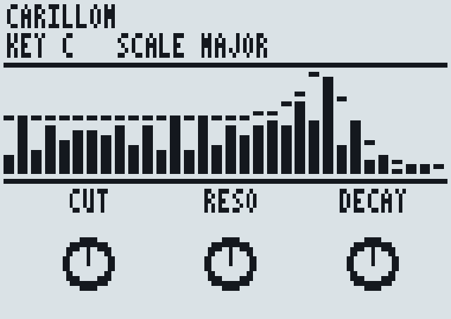

# Carillon

A resonant filter bank, after the one in the Torso S-4. 32 narrow band-pass
filters from C2 to C8, each tuned to a note of the key and scale you pick. At
low Decay they work together as one filter you shape with Cutoff, Reso and
Slope. Turn Decay up and every band starts to ring on its own, until whatever
you play sets off a bank of tuned bells.

MS-70CDR, Delay group, effect ID 497. File: [dist/Carillon.ZDL](../../../dist/Carillon.ZDL).

## Knobs

| Knob | Range | What it does |
|---|---|---|
| Cut (Cutoff) | 0–100 | Where the filter's emphasis sits, from below C2 to above C8 |
| Reso | 0–100 | Boosts the bands around Cutoff, like a filter's resonance |
| Decay | 0–100 | How narrow each band is and how long it rings. **0** one plain filter, **50** about a second of ring, **100** bells: a few seconds in the middle, longest in the low bands |
| Key | C … B | The scale's root. In Free, moves the whole bank up in semitones |
| Scale | Free, Chrom, Major, Minor, Dor, Pent, MinPt, Whole, Fifth, Oct | The notes the bands snap to. Free leaves them evenly spaced. In Fifth and Oct several bands land on the same note, so fewer ring |
| Slope | 0–100 | **0** low-pass, **50** band-pass, **100** high-pass |
| Waves | 0–100 | A slow ripple across the bands. **Up to 50:** deeper. **50 and up:** full depth, faster (about 0.1 to 2.5 Hz) |
| Noise | 0–100 | **Up to 50:** random bands are struck on their own, more often as you turn it up. **50 and up:** up to 20 a second, and a quiet hiss that makes the bank whistle |
| Mix | 0–100 | Dry/wet |

The bank is mono going in (L and R mixed). Even bands lean left and odd ones
right, so the ringing spreads across the stereo field.

The level is evened out as Decay narrows the bands (measured on DI guitar).
Notes that land right on a band ring loudest: pure synth tones in the key come
out louder at high Decay, and a limiter holds the peaks. Playing in the key
and scale you set gives the most ring; notes between the bands pass through
quietly.

## Screen

On firmware 2.10 the screen shows a bar per band (its level as it rings) and a
mark per band at the filter's shape (Cutoff, Reso, Slope and Waves together),
with the Key and Scale in the header. A band snapped onto its neighbour's note
shows as a dot. On other firmware the still cover stays and the audio works the
same.

## How it works

Each band is a Chamberlin state-variable filter, which stays in tune down to
C2, where a biquad's coefficients run out of float precision. Decay sets each
band's width (Q 3 to about 3000) and caps its ring at 0.15 to 10 s. The
coefficients are refreshed a quarter of the bank at a time, every 8 samples.

## Building

    python3 src/custom/carillon/build.py

Writes `dist/Carillon.ZDL` and its Effect Manager thumbnail. `host.c` runs the
same DSP on a computer (WAV in, WAV out, optional screen frames, one knob
turned mid-run); see its header.
