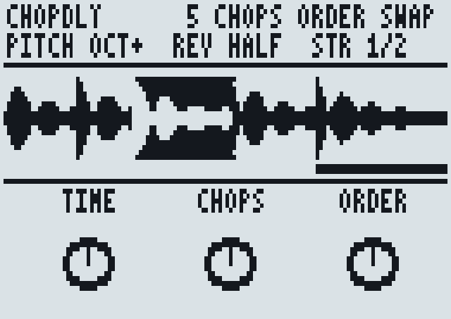

# Chopdly

A delay that chops what it recorded. Every cycle (one delay time long) it
replays the last cycle's audio cut into chops. Each chop keeps its place in
time, but what plays there is another chop's audio, optionally reversed,
pitched or stretched. The output feeds back into the recording, so repeats get
re-chopped.

MS-70CDR, Delay group, effect ID 947. File: [dist/Chopdly.ZDL](../../../dist/Chopdly.ZDL).

## Knobs

| Knob | Range | What it does |
|---|---|---|
| Time | 0–100 | Cycle length, 30 ms to 2.5 s |
| Chops | Trans, 1–16 | Equal chops, or **Trans**: cut at your note attacks, at the quietest point in the ~23 ms before each, so the previous chop ends in a gap or a zero crossing (4 equal chops if it finds none) |
| Order | named steps | Which chop plays in each slot (below) |
| Pitch | named steps | **−12, −7, −5, Unity, +5, +7, +12**: every chop. **Oct+ / Oct−**: half the chops an octave up / down. **Octs**: a third up, a third down. **Fifth**: a third +7, a third −5. **Some**: half the chops jump ±5, 7 or 12. **Wild**: every chop jumps |
| Reverse | Off, Few, Alt, Half, Most, All, Ping, Scatr | How many chops play backwards. Few, Half and Most are about 1/4, 1/2 and 3/4, and each includes the chops the step below reverses. Alt is every other chop. **Ping** and **Scatr** are stereo instead: chops play forward, Ping alternates them hard left and right, Scatr gives each chop its own fixed place in the stereo field |
| Stretch | 1/4, 1/3, 1/2, 3/4, Off, 1.5x, 2x | How fast each chop runs through its audio, pitch kept (two-grain crossfade). Pitch still applies on top |
| Glide | 0–100 | How chops join. **0**: hard cuts where they were chopped (a tiny anti-click fade). Turning it up lengthens each chop's fade in and out, to half the shorter neighbouring chop at 100, and lets the ending chop ring on under the next one so they crossfade instead of dipping |
| Feedbk | 0–100 | Chopped output back into the recording, limited |
| Mix | 0–100 | Dry/wet |

Order, with 8 chops numbered 0–7 in the order they were recorded:

| Step | Plays |
|---|---|
| Fwd | 0 1 2 3 4 5 6 7 |
| Back | 7 6 5 4 3 2 1 0 (each chop still forward) |
| Swap | 1 0 3 2 5 4 7 6 |
| Skip | 0 2 4 6 1 3 5 7 |
| Stutr | 0 0 2 2 4 4 6 6 |
| Build | 0, 0 1, 0 1 2 … |
| Mix1–Mix8 | Fixed shuffles, every chop once |
| Rpt1–Rpt6 | Fixed random patterns, chops repeat or drop out |
| Rand | A new shuffle every cycle |
| Chaos | A new random pattern every cycle, with repeats |

A chop pitched up or stretched past its own audio carries on into what was
recorded after it (before it, reversed), and turns back rather than jump if
that isn't recorded yet.

Everything but Rand and Chaos is fixed per setting, so a saved patch sounds the
same every time.

## Stereo

Chopdly records one mono signal, L and R mixed. The dry signal stays stereo. The
chops come out the same on both sides, except with Reverse on Ping or Scatr.
Feedback is always mono, so each repeat is re-panned by its new slot. With
Ping and only L Out plugged, every other chop is silent.

## Screen

On firmware 2.10 the screen shows the cycle being chopped as a waveform, dotted
lines at the cuts, the chop playing now (inverted) with its playhead, a marker
for the slot playing, and two lines of the current settings: chop count, Order,
Pitch, Reverse and Stretch. On other firmware the still cover stays and the
audio works the same.

## Building

    python3 src/custom/chopdly/build.py

Writes `dist/Chopdly.ZDL` and its Effect Manager thumbnail. `host.c` runs the
same DSP on a computer (WAV in, WAV out, optional screen frames); see its header.
