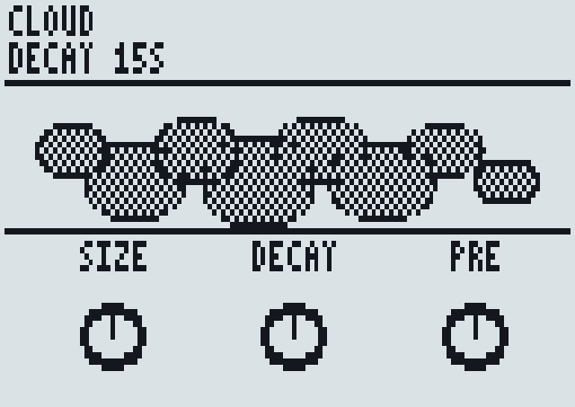

# Cloud

A dense, diffuse ambient reverb. A note doesn't hit it, it blooms into it,
and the tail turns to fog instead of echoes. Built for density per byte:
[HorizonL](../horizonl/README.md)'s half-rate tank with an allpass inside
each of its eight lines, after five long input diffusers. Every trip round
the loop multiplies the echoes instead of repeating them, so even a small
Size doesn't flutter.

MS-70CDR, Delay group, effect ID 423. File: [dist/Cloud.ZDL](../../../dist/Cloud.ZDL).
Not yet tried on the pedal.

## Knobs

| Knob | Range | What it does |
|---|---|---|
| Size | 0–100 | The space: the eight lines from x0.4 to x2.0 (about 12 to 168 ms, plus 10 to 23 ms of allpass each). Turning it bends the tail's pitch |
| Decay | 0–100 | Reverb time, 1 s to 90 s (40 is about 6 s, 60 about 15 s). **100 holds** the tail forever and takes no new sound |
| Pre | 0–100 | Pre-delay, 0 to 370 ms |
| Diff | 0–100 | The smear. At 0 the lines' echoes can still be heard; at 100 no attack is left |
| Mod | 0–100 | Slow movement of the lines: a chorus in the tail at middle settings, a detune at the top |
| Tone | 0–100 | How long the highs last: at 100 about as long as the rest, at 0 a fifth of that |
| Lo | 0–100 | How long the lows (under about 250 Hz) last: at 0 a little longer than the rest, at 100 a sixth |
| Swell | 0–100 | Each note blooms in over up to 2 s instead of starting at once. 0 is off |
| Mix | 0–100 | Dry/wet |

Tone and Lo don't shorten the tail. Each line's filters are set from its
own feedback gain, so the middle of the spectrum always decays in the time
Decay asks for, and the highs and the lows only decay faster or slower
than that. (Horizon's low and high cuts sit in the loop as plain filters,
so turning them also shortens the whole tail.)

The reverb takes the input in mono and spreads the tail wide (left and right
uncorrelated); the dry signal keeps its stereo. A soft limiter on the wet
signal catches the build-up of a small Size with a near-infinite Decay.

## How dense?

Measured on the desktop build (`host.c`), Size 65, Decay 60, Mod 40:

| | Half level after a note | Peak after a note |
|---|---|---|
| Horizon | 53 ms | 116 ms |
| Cloud, Diff 0 | 166 ms | 218 ms |
| Cloud, Diff 75 | 142 ms | 300 ms |
| Cloud, Diff 100 | 117 ms | 303 ms |

Reverb times (Tone 100, Lo 0) match the knob within 2% from 1 s to 37 s.

## Screen

On firmware 2.10 (and the G1on family) the screen shows the eight lines as
eight puffs of one cloud, each as big as the sound in its line, drifting
with Mod. With Diff above 50 their fill is a checkerboard, below it a
sparser dot grid. The header shows the reverb time, or HOLD. One puff is
drawn per callback.

## DSP

About 6,100 emulated cycles per callback (Horizon 7,400, HorizonL 5,250),
8,900 at the screen's heaviest step, so it declares a DSP cost of 45.
Memory: about 215 KB of the effect's memory (8 x 4096-sample lines, 8 x 512
loop allpasses, 5 x 1024 diffusers, an 8192-sample pre-delay, all at the
tank's 22.05 kHz), cleared a piece per callback when it loads (about 25
callbacks, 4.5 ms of dry signal). Stack frame 252 bytes. The TI build in
the emulator matches the desktop build.

## Building

    python3 src/custom/cloud/build.py

Writes `dist/Cloud.ZDL` and its Effect Manager thumbnail. `host.c` runs the
same DSP on a computer (WAV in, WAV out, optional screen frames, one knob
turned mid-run, a tail of CLOUD_TAIL seconds); see its header.
