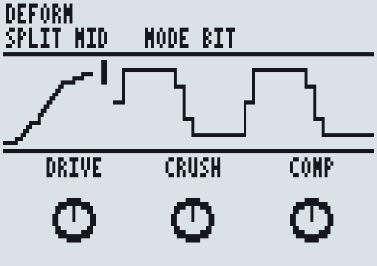

# Deform

Drive, crush and compression in one, after the Torso S-4's Deform. In its
order: noise that follows your playing, a two-band drive, the crush, then a
one-knob compressor.

The crush is built to stay soft rather than fizzy:

- **Bit** has rounded steps instead of hard corners.
- Quiet signals get more of the levels, so a decaying note crumbles instead
  of cutting out.
- The error is fed back so the grit sits low.
- **Redux** draws straight lines between the held samples and filters after
  them, instead of the usual hard stair steps with their harsh high images.

MS-70CDR, Delay group, effect ID 417. File: [dist/Deform.ZDL](../../../dist/Deform.ZDL).

## Knobs

| Knob | Range | What it does |
|---|---|---|
| Drive | 0–100 | 0 to +36 dB into a soft, slightly uneven clipper (some even harmonics). The level stays about even; a little louder at the top |
| Crush | 0–100 | How far the crush goes; 0 is off. **Bit:** about 8 bits down to under 2. **Redux:** 44.1 kHz down to about 1.4 kHz |
| Comp | 0–100 | One-knob compressor: threshold and ratio together (soft knee, 3 ms attack, 150 ms release), level made up |
| Tilt | 0–100 | **50** flat. Above 50 the highs are pushed into the drive and the lows held back; below 50 the other way. Half of it is undone after the drive, so it changes where the drive bites more than the tone |
| Split | Low, Mid, High | Tilt's crossover: 80 Hz, 650 Hz, 2.5 kHz |
| Mode | Bit, Redux, Both | Fewer levels, a lower sample rate (with a little jitter), or both at once (each a bit gentler) |
| Noise | 0–100 | Pink noise that follows your playing. It's added before the drive, so it's driven and crushed with the guitar. Silent when you are |
| Decay | 0–100 | How long the noise hangs on after you stop, 20 ms to 2 s |
| Mix | 0–100 | Dry/wet |

The input is processed in stereo (L and R each through the chain), with one
compressor for both sides.

## Screen

On firmware 2.10 the screen shows three things:

- On the left, the drive and crush curve: what comes out for each input level.
  It bends with Drive, and turns into steps at high Crush in Bit mode.
- The compressor's gain reduction, hanging from the top: 0 to 20 dB.
- On the right, the wet signal, one cycle caught at a rising zero crossing.

The header shows Split and Mode. On other firmware the still cover stays and
the audio works the same.

## Building

    python3 src/custom/deform/build.py

Writes `dist/Deform.ZDL` and its Effect Manager thumbnail. `host.c` runs the
same DSP on a computer (WAV in, WAV out, optional screen frames, one knob
turned mid-run); see its header. Built with `-DDF_NOLEVEL` it skips the level
compensation after the drive, which is how that was measured.
