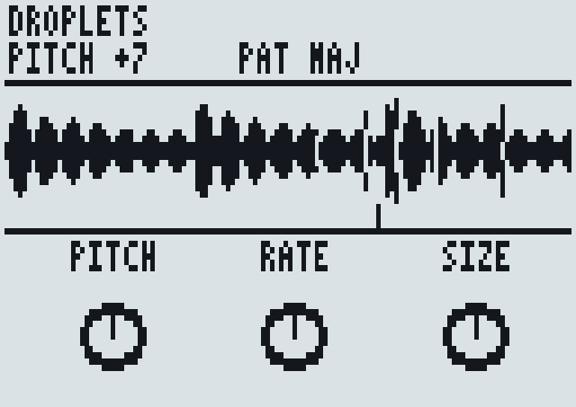

# Droplets

A granular delay. It keeps the last few seconds of what you play and sprays
short grains (droplets) from it: up to 8 at once, each with its own start
point, pitch, length, envelope, level, direction and place in the stereo
field. Feedback writes the grains back in, and Lock freezes the buffer so the
grains keep playing from one moment while you play over it.

MS-70CDR, Delay group, effect ID 422 (492 until version 0.03). File: [dist/Droplets.ZDL](../../../dist/Droplets.ZDL).

## Knobs

| Knob | Range | What it does |
|---|---|---|
| Pitch | −24, −12, −7, −5, −3, Unity, +3, +5, +7, +12, +24 | Every grain's pitch, in semitones |
| Rate | 0–100 | How often a grain starts, about 2 to 60 a second |
| Size | 0–100 | Grain length, 10 to 250 ms. Long grains blur into sustained notes, short ones turn into blips |
| Contour | 0–100 | Grain envelope: **0** a sharp hit that decays, **50** smooth, **100** a slow swell with a sharp end |
| Scan | 0–100 | **Below 50:** where the grains start, from 30 ms to 2.5 s behind what you play (a place in the frozen buffer when locked). **50 and up:** the start point travels through the last 2.5 s, standing still at 50 and moving at up to twice speed at 100 |
| Pattern | Off, Oct, Oct−, Fifth, Pwr, Maj, Min, Down, Sus, Pent, Wide | A pitch sequence stepped grain by grain, on top of Pitch. Oct to Sus cycle (Maj: 0, +4, +7, +12). Pent and Wide pick at random: from a major pentatonic over two octaves, or from octaves and fifths |
| Random | 0–100 | **Up to 33:** spray (each grain starts up to 0.5 s from the scan point) and stereo spread. **To 66:** adds random pitch jumps (−12, −5, +7, +12), length, timing and level. **To 100:** adds reversed grains, up to half |
| Feedbk | 0–100 | Grains back into the buffer. **100 = Lock:** nothing new is recorded and the grains play from the frozen buffer |
| Mix | 0–100 | Dry/wet |

The grains are mono going in (L and R mixed) and spread across L and R coming
out. When more grains overlap the level is evened out, so dense and sparse
settings sit at similar volumes.

To lock a moment: play, turn Feedbk to 100, then play over it. Scan below 50
then picks the place in the frozen 2.5 s; above 50 it sweeps through it.

## Screen

On firmware 2.10 the screen shows the last 2.5 s as a waveform (oldest on the
left), a line for each grain where it is reading (taller while its envelope
is open), the scan point under the waveform, the Pitch and Pattern steps, and
LOCK while frozen. On other firmware the still cover stays and the audio
works the same.

## Building

    python3 src/custom/droplets/build.py

Writes `dist/Droplets.ZDL` and its Effect Manager thumbnail. `host.c` runs the
same DSP on a computer (WAV in, WAV out, optional screen frames, one knob
turned mid-run); see its header.
