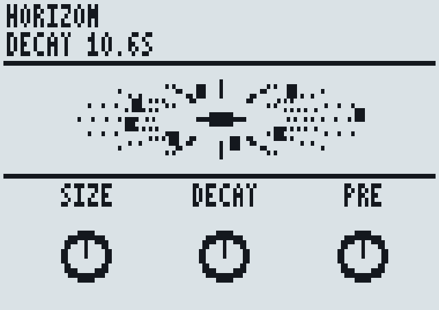

# Horizon

A huge, spacey reverb. Pre-delay, four diffusers that smear the attack, then
eight long delay lines that move slowly and feed each other through an
orthogonal mixing matrix, so the tail keeps its energy and only loses what
Decay and the cuts take. The lines run from tens to nearly two hundred
milliseconds: the space goes from a room to a cathedral. Turning
Size bends the tail's pitch as the lines stretch, like a tape slowing down.
At the top of Decay the tail holds forever.

MS-70CDR, Delay group, effect ID 419. File: [dist/Horizon.ZDL](../../../dist/Horizon.ZDL).

## Knobs

| Knob | Range | What it does |
|---|---|---|
| Size | 0–100 | The space: the eight lines from x0.35 to x1.52 (about 13 to 183 ms). Turning it bends the tail's pitch |
| Decay | 0–100 | Reverb time, 0.8 s to about a minute (60 is about 11 s). **100 holds** the tail forever and takes no new sound: play, turn it to 100, play over it |
| Pre | 0–100 | Pre-delay, 0 to 370 ms |
| Mod | 0–100 | Slow movement of the lines: a chorus in the tail at middle settings, a shimmer of detune at the top |
| Lo | 0–100 | Low cut inside the tail, 20 to 600 Hz: the lows die away first |
| Hi | 0–100 | High cut inside the tail, 1.5 to 16 kHz: dark to bright |
| Swell | 0–100 | Each note blooms into the reverb instead of hitting it, over up to 2 s. 0 is off |
| Width | 0–100 | Stereo width of the tail, mono to extra wide. Left and right are uncorrelated |
| Mix | 0–100 | Dry/wet |

The reverb takes the input in mono; the dry signal keeps its stereo. A soft
limiter on the wet signal catches the build-up of a small Size with a near
infinite Decay.

## Screen

On firmware 2.10 the screen shows the eight delay lines as eight orbits
around the horizon, each as wide as its line is long, each dot lit by the
sound in its line. The header shows the reverb time, or HOLD.

## DSP

About 6,000 emulated cycles per callback, plus the memory traffic of its
lines (about 330 KB of the effect's memory), so it declares a DSP cost of
50. Version 0.01 used 650 KB, more than any effect proven on the pedal,
and was installed when the pedal froze; 0.02 halves it and keeps its
stack frame at 260 bytes. 0.02 runs on the pedal (2026-11-15), but crackles next to Carillon: for busy chains use [HorizonL](../horizonl/README.md). The buffers are cleared a piece per callback when it loads (about
15 ms of dry signal). The screen's drawing is spread over seven callbacks.

## Building

    python3 src/custom/horizon/build.py

Writes `dist/Horizon.ZDL` and its Effect Manager thumbnail. `host.c` runs the
same DSP on a computer (WAV in, WAV out, optional screen frames, one knob
turned mid-run, a tail of HORIZON_TAIL seconds); see its header.
